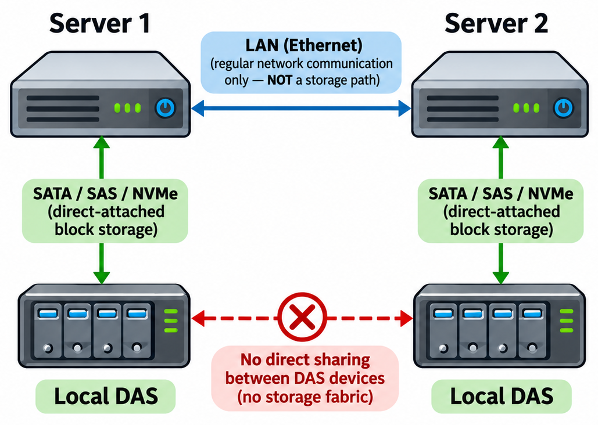
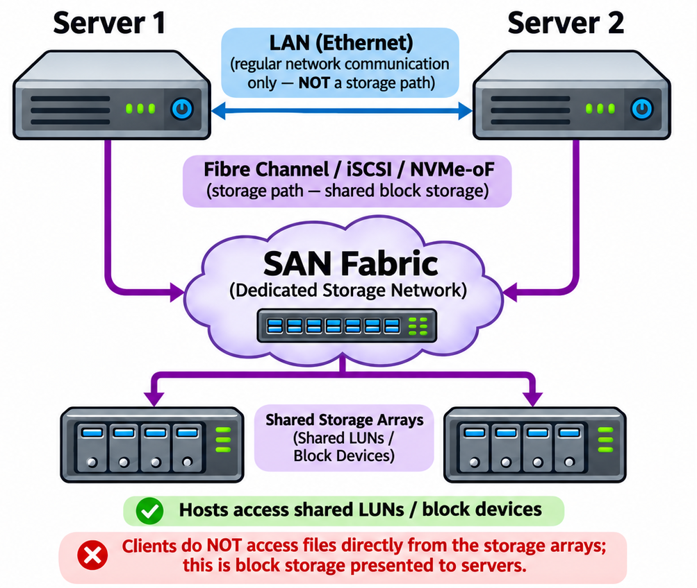
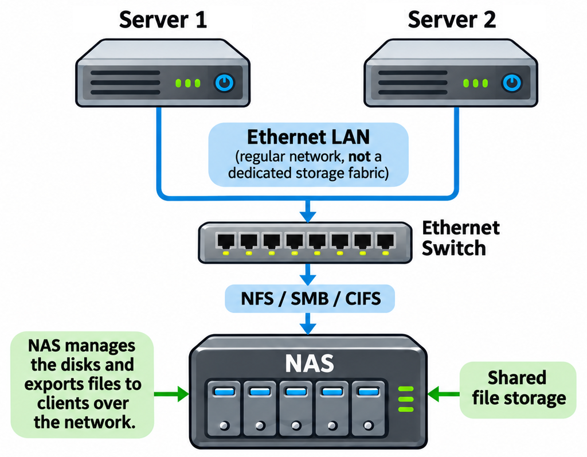
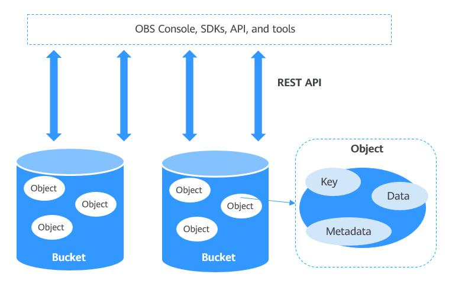
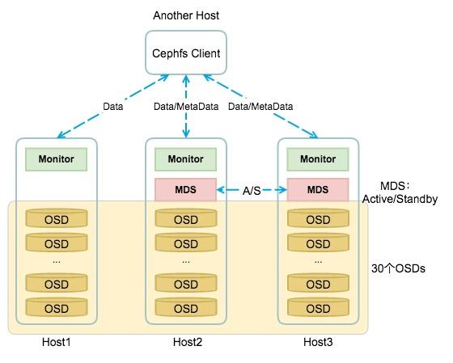

# Storage Types

Storage systems differ in **how they organize data**, **where they run**, and **how clients access them**. The table below provides a quick comparison, with detailed explanations in the sections that follow.

| **Storage Type**                     | **Access Granularity**           | **Managed By**                    | **Typical Interfaces / Protocols**                | **Examples**                                |
| ------------------------------------ | -------------------------------- | --------------------------------- | ------------------------------------------------- | ------------------------------------------- |
| **Direct-Attached Storage (DAS)**    | Fixed-size blocks                | Local OS (via filesystem)         | IDE/ATA, SATA, SAS, NVMe                          | Internal SSDs, HDDs, USB drives             |
| **Storage Area Network (SAN)**       | Fixed-size blocks                | Centralized storage fabric        | Fibre Channel (FC), iSCSI, FCoE, NVMe-oF          | Dell EMC PowerStore, NetApp, AWS EBS        |
| **Network-Attached Storage (NAS)**   | Files and directories            | Remote file server                | NFS, SMB/CIFS, AFS                                | Synology NAS, QNAP, Amazon EFS              |
| **Object Storage**                   | Objects (data + metadata + ID)   | Application or API layer          | REST API (HTTP/S3, Swift, etc.)                   | Amazon S3, Google Cloud Storage, MinIO      |
| **Distributed / Cluster Filesystem** | Files (distributed across nodes) | Clustered metadata + data servers | Custom client or FUSE; sometimes NFS/SMB gateways | GlusterFS, CephFS, Lustre, HDFS             |

## Direct-Attached Storage (DAS)

Direct-Attached Storage refers to any storage device that connects directly to a single host computer, without any intervening network. Think of the hard drive or SSD inside your laptop — that is DAS.

Common interfaces include:

- **IDE/ATA** (1986) — an older parallel interface, largely replaced by SATA.
- **SATA** (Serial ATA, 2003) — the most common interface for consumer HDDs and SSDs.
- **SAS** (Serial Attached SCSI, 2004) — an enterprise-grade interface with higher reliability and speed than SATA.
- **NVMe** (Non-Volatile Memory Express, 2011) — a high-speed interface that uses the PCIe bus, either through a direct slot (M.2, add-in card) or a cable (U.2, OCuLink).

All of these interfaces use **block addressing**, where data is read and written in fixed-size units called *blocks* (typically 512 bytes or 4 KB). The operating system's filesystem (such as ext4, NTFS, or APFS) manages how these blocks map to the files and directories you see.

DAS offers low latency and high throughput because there is no network between the host and the storage. However, it has limited scalability — only the directly connected system can access the data.

**Typical use cases:** boot drives, local application storage, and single-server workloads.

## Storage Area Network (SAN)

A Storage Area Network is a dedicated, high-speed network designed to give multiple servers access to shared storage. It separates storage from individual hosts, allowing centralized management and flexible provisioning.

Common SAN technologies include:

- **Fibre Channel (FC, 1994)** — a high-speed, low-latency protocol purpose-built for storage traffic.
- **iSCSI** (Internet SCSI, 2003) — carries SCSI commands over standard TCP/IP networks, making it more affordable than FC.
- **FCoE** (Fibre Channel over Ethernet, 2009) — combines Fibre Channel with Ethernet to reduce cabling complexity.
- **NVMe-oF** (NVMe over Fabrics, 2016) — extends the NVMe protocol across a network fabric (RDMA, Fibre Channel, or TCP), delivering near-local NVMe performance over a SAN.

Like DAS, a SAN operates at the **block level**. Remote storage volumes appear to each server as if they were local disks, so any standard filesystem can be layered on top.

SANs are widely used in enterprise data centers for workloads that demand high throughput, low latency, and redundancy — such as databases, virtual machines, and clustered applications.

They are more complex and expensive to deploy than NAS, but provide superior performance and fault tolerance for block-oriented workloads.

> **Note — The role of RDMA in SANs:**
> Some SAN protocols (notably NVMe-oF and iSCSI via iSER) can run over **RDMA** (Remote Direct Memory Access) transports such as **InfiniBand** or **RoCE** (RDMA over Converged Ethernet). RDMA allows one server to read from or write to another server's memory directly, bypassing the CPU and OS networking stack entirely. This eliminates copy and context-switch overhead, resulting in low latency and high throughput — critical for latency-sensitive workloads like databases, real-time analytics, and AI/ML training. InfiniBand is common in HPC and data center environments, while RoCE brings RDMA capabilities to standard Ethernet infrastructure at a lower cost.

## Network-Attached Storage (NAS)

Network-Attached Storage operates at the **file level**, unlike DAS and SAN, which operate at the block level. Instead of exposing raw disk blocks, a NAS device has its own operating system and filesystem. Clients interact with it through familiar file operations — open, read, write, and delete — over the network.

NAS uses a client–server architecture: the NAS server hosts the filesystem and grants access through standard network protocols.

| **Protocol**                        | **Year** | **Description**                                                                                  |
| ----------------------------------- | -------- | ------------------------------------------------------------------------------------------------ |
| SMB (Server Message Block)          | 1983     | Designed by Barry Feigenbaum at IBM for file and printer sharing over PC networks.               |
| NFS (Network File System)           | 1984     | Developed by Sun Microsystems; the dominant file-sharing protocol on UNIX/Linux systems.         |
| AFS (Andrew File System)            | 1984     | Developed at Carnegie Mellon University; a distributed filesystem with client-side caching and replication. |
| CIFS (Common Internet File System)  | 1996     | An updated version of SMB by Microsoft, optimized for Windows environments.                      |
| Amazon EFS (Elastic File System)    | 2016     | A fully managed cloud NAS by AWS, providing scalable shared file storage over the NFS protocol.  |

Because the NAS device manages file permissions, directory structures, and data sharing on behalf of clients, it is simpler and cheaper to deploy than a SAN. The trade-off is higher latency and lower throughput for block-oriented workloads, since every request passes through the file-level protocol layer.

**Typical use cases:** shared file access, enterprise file shares, home directories, backups, and media streaming.

## Object Storage

Object storage is a data storage architecture designed to manage vast amounts of **unstructured data** — such as images, videos, backups, logs, and datasets. Instead of organizing data into a hierarchy of directories and files, object storage uses a **flat namespace**. Each piece of data is stored as a discrete *object* consisting of three parts:

1. **Data** — the actual content (e.g., a photo or log file).
2. **Metadata** — descriptive attributes (e.g., creation date, content type, custom tags).
3. **Object ID** — a globally unique identifier used to retrieve the object.

The following table lists some widely used object storage platforms and services:

| **Service / Platform**     | **Year** | **Description**                                                                          |
| -------------------------- | -------- | ---------------------------------------------------------------------------------------- |
| Ceph (RADOS Gateway)       | 2006     | Open-source distributed storage supporting block, object, and file interfaces.           |
| Amazon S3                  | 2006     | Scalable object storage by AWS with high durability and availability.                    |
| Azure Blob Storage         | 2010     | Microsoft's cloud-based object storage, launched with Windows Azure GA.                  |
| Google Cloud Storage       | 2010     | Object storage with multi-region, nearline, and coldline tiers for cost efficiency.      |
| OpenStack Swift            | 2010     | Open-source distributed object storage for large-scale deployments.                      |
| MinIO                      | 2015     | Open-source, S3-compatible object storage for private cloud and on-premise environments. |
| IBM Cloud Object Storage   | 2016     | IBM's managed object storage service, built on Cleversafe's dispersed storage technology.|

Clients interact with object storage through **RESTful API calls** (PUT, GET, DELETE) over HTTP/HTTPS, rather than through filesystem commands. This makes it naturally suited to distributed cloud environments.

Object storage systems scale **horizontally** — new storage nodes can be added without complex reconfiguration. They are optimized for **write-once, read-many** workloads (data that is written once and read frequently but rarely modified), rather than frequent in-place updates.

To ensure durability and fault tolerance, object storage systems use mechanisms like **replication** (copying data to multiple nodes) or **erasure coding** (splitting data into fragments with parity, so it can be reconstructed even if some fragments are lost).

Because metadata is extensive and customizable, object storage also supports powerful search, classification, and lifecycle management capabilities — making it the backbone of modern cloud storage.

## Distributed Filesystems

A Distributed Filesystem stores data across multiple servers or nodes, typically within a data center or compute cluster. Instead of relying on a single machine for storage, the data and its metadata are spread across many machines — allowing the system to scale to petabytes of capacity and thousands of concurrent clients.

From a user's perspective, a distributed filesystem looks and behaves like a regular local filesystem — applications use standard file operations (open, read, write, close) without needing to know that the data is physically spread across a cluster.

**How they work:**

At their core, distributed filesystems separate two concerns:

- **Metadata servers (MDS)** — coordinate namespace operations such as creating, renaming, and deleting files. They track where each file's data is stored across the cluster.

- **Data servers (OSD / storage nodes)** — store the actual file contents, distributed across many disks and machines.

This separation enables massive parallelism: many clients can read or write different parts of the same or different files simultaneously.

| **Filesystem**                        | **Year** | **Description**                                                            |
| ------------------------------------- | -------- | -------------------------------------------------------------------------- |
| DCE/DFS (Distributed File System)     | 1991     | Developed by Transarc as part of OSF's Distributed Computing Environment. |
| GFS (Global File System)              | 1996     | A shared-disk filesystem developed at the University of Minnesota; later acquired by Red Hat. |
| Lustre                                | 2003     | A high-performance parallel filesystem for large-scale cluster computing.  |
| GlusterFS                             | 2006     | A scalable distributed filesystem for cloud and containerized environments.|
| CephFS                                | 2006     | A distributed filesystem built on top of the Ceph storage platform.        |
| HDFS (Hadoop Distributed File System) | 2006     | Built for big data processing within the Hadoop ecosystem.                 |

These filesystems are built to handle **petabyte-scale data** and tolerate node failures without service interruption, using mechanisms like replication, erasure coding, and automatic data rebalancing.

The trade-off is complexity: they require cluster coordination and specialized software, making them harder to deploy and manage than traditional NAS or SAN solutions.

**Typical use cases:** HPC (High-Performance Computing), AI/ML training, large-scale analytics, and cloud-native workloads where distributed computation and massive datasets are the norm.

[Next: HDD Structure →](02_hdd_structure.md)
