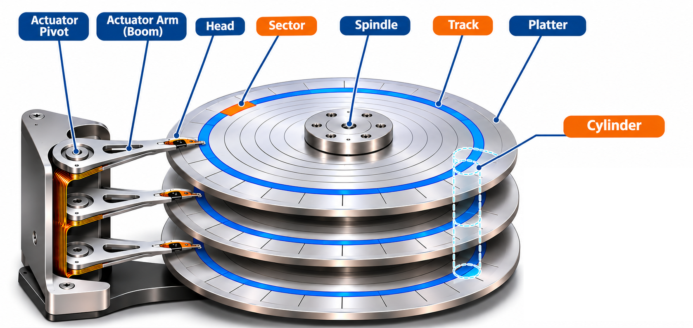
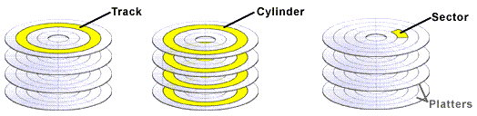
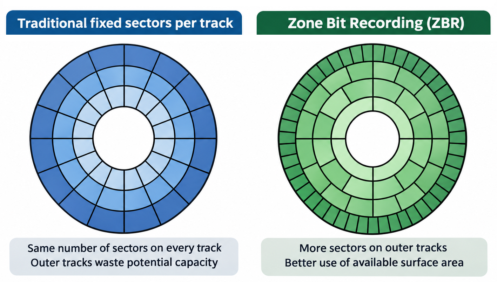

# Hard Disk Drive (HDD) Structure

A Hard Disk Drive (HDD) is a storage device that reads and writes data magnetically on spinning disks. It is **non-volatile**, meaning it retains data even when powered off. Think of it like a vinyl record player — but instead of a needle reading grooves of music, a magnetic head reads and writes data on spinning platters.

The diagram below shows the key physical components of an HDD:

> **Why cover HDDs?** Solid-State Drives (SSDs) have largely replaced HDDs for everyday use due to their faster speeds, lower latency, and lack of moving parts. However, understanding HDD structure is still important because:
> - Many foundational storage concepts — sectors, tracks, cylinders, CHS/LBA addressing — originate from HDD design and still influence how modern operating systems, partitioning schemes, and filesystems work.
> - HDDs remain widely used in data centers, NAS devices, and archival storage where **cost per terabyte** matters more than speed.
> - Much of the terminology you'll encounter in later topics (partitioning, MBR, block devices) assumes familiarity with HDD internals.

📺 **Video:** [What's Inside a Hard Drive?](https://youtu.be/p-JJp-oLx58) — a short teardown showing HDD internals and how the components work in practice.

## Physical Components

### Platter

A platter is a circular disk inside the HDD that stores data on its magnetic surface. Platters are made of glass or aluminum, coated with a thin magnetic layer. Each platter has **two surfaces** (top and bottom), and both can store data. A typical HDD contains one or more platters stacked together — the diagram above shows an HDD with three platters (six usable surfaces).

### Spindle

The spindle is a motorized shaft at the center of the drive that holds and spins the platters at a constant speed. Common rotational speeds include:

- **5,400 RPM** — common in laptops and energy-efficient drives.
- **7,200 RPM** — standard for desktop drives.
- **10,000–15,000 RPM** — used in enterprise/server drives for lower latency.

RPM (Revolutions Per Minute) directly affects how quickly data can be read — a faster spin means the desired data passes under the read/write head sooner.

### Head

The head (read/write head) is a tiny electromagnetic component that hovers just above (or below) a platter surface. It reads data by detecting magnetic field changes and writes data by magnetizing tiny regions on the surface. Each platter surface has its own dedicated head.

### Actuator Arm (Boom)

The actuator arm (also called the boom) is the mechanical arm that carries the heads and positions them over the correct track on the platter. All heads move together as a single unit when the arm swings.

### Actuator Pivot

The actuator pivot is the rotational bearing that the actuator arm pivots on. It allows the arm to swing the heads radially across the platter surfaces, driven by a voice coil motor for precise, rapid positioning.

## Data Layout

The following diagram illustrates how data is organized on the platters — showing tracks, cylinders, and sectors:

### Track

Each platter surface is divided into concentric circles called **tracks**. Data is stored along these circular paths. Tracks are numbered starting from the outermost edge of the platter (track 0) inward. A single platter surface may have tens of thousands of tracks.

### Cylinder

A cylinder is the set of tracks at the **same position across all platter surfaces**. For example, track 100 on the top of platter 1, track 100 on the bottom of platter 1, track 100 on the top of platter 2, and so on — together these form cylinder 100.

Cylinders are important for performance: once the actuator arm moves the heads to a given cylinder, **all heads are aligned** and can read their respective tracks without any additional arm movement.

> **Example:** A drive with 4 platters (8 surfaces) and 10,000 tracks per surface has **10,000 cylinders**, each spanning 8 tracks (one per surface).

### Sector

Each track is divided into small, fixed-size segments called **sectors**. A sector is the smallest unit of data the drive can read or write in a single operation.

- **Traditional sector size:** 512 bytes (used for decades).
- **Advanced Format (AF):** 4,096 bytes (4 KB) — adopted by modern drives since ~2010 for improved efficiency and error correction.

Sectors are the foundation of all disk addressing. When the operating system reads or writes a file, it ultimately translates that request into one or more sector-level operations.

Notice in the diagram that outer sectors are **physically larger** than inner sectors. This is because outer tracks have a greater circumference. How drives handle this difference has changed over time:

**Traditional layout:** Every track has the **same number of sectors**, regardless of its position on the platter. Since each sector stores the same amount of data (e.g., 512 bytes), the bits on outer tracks are spread further apart — resulting in lower **bit density** and wasted magnetic surface. About half the potential storage capacity on outer tracks goes unused.

**Zone Bit Recording (ZBR):** The disk is divided into radial **zones**, and outer zones are assigned **more sectors per track** than inner zones. This keeps bit density roughly uniform across the entire surface, maximizing storage capacity.

| Layout | Sectors per Track | Outer Track Bit Density | Capacity Use |
|--------|-------------------|-------------------------|--------------|
| Traditional | Same on all tracks | Lower (bits spread apart) | ~50% wasted on outer tracks |
| Zone Bit Recording | More on outer tracks | Roughly uniform | Near-optimal |

Both approaches spin the disk at a fixed RPM — this is called **Constant Angular Velocity (CAV)**. With the traditional layout this is simply called **CAV**. With zone bit recording it is called **Zoned CAV (ZCAV)** — the spin speed stays constant, only the sector layout changes.

A side effect of ZCAV is that **data transfer is faster on outer tracks** because more sectors pass under the head per rotation. Drives number tracks starting from the outer edge, and operating systems fill lowest-numbered tracks first — so a freshly installed system gets the fastest part of the disk. As the drive fills inward, average transfer rates drop.

> **Note:** CD-ROMs and DVDs take a different approach — **Constant Linear Velocity (CLV)** — where the spin speed varies (slower at the outer edge, faster at the center) to keep bit density and transfer rate uniform everywhere. HDDs avoid this because changing spin speed on every seek would be too slow.

## CHS Addressing

Early systems located data on an HDD using **CHS (Cylinder-Head-Sector)** addressing. Each sector on the disk was identified by three values:

| Component    | Meaning                                              |
| ------------ | ---------------------------------------------------- |
| **Cylinder** | Which cylinder (i.e., which radial position)         |
| **Head**     | Which platter surface (i.e., which read/write head)  |
| **Sector**   | Which sector within that track (numbered from 1)     |

For example, **CHS (100, 3, 12)** means: cylinder 100, head 3 (the 4th surface), sector 12.

CHS addressing was eventually replaced by **LBA (Logical Block Addressing)**, which assigns a simple sequential number to every sector on the disk (starting from 0). LBA is simpler, supports larger drives, and is used by all modern systems. The disk's firmware handles the translation from LBA to the physical CHS location internally.

[← Previous: Storage Types](01_storage.md) | [Next: Partitioning →](03_partitioning.md)
