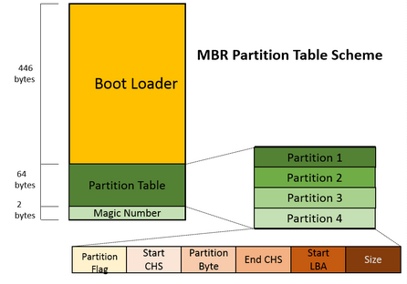
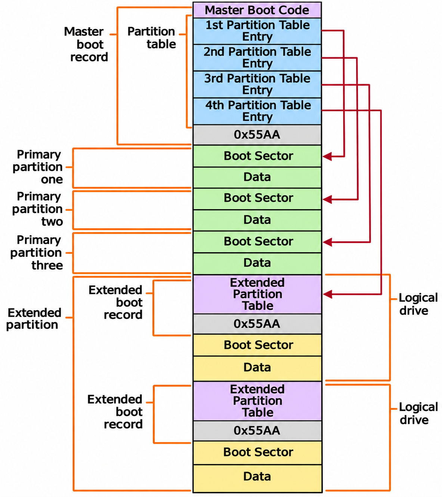

# MBR (Master Boot Record)

The Master Boot Record (MBR) is a partitioning scheme introduced in 1983 with IBM PC DOS 2.0. A partitioning scheme defines how partition information is stored on a disk — where partitions begin, how large they are, and which one to boot from. MBR was designed for early PC systems and, despite its age, is still supported for backward compatibility. It has been largely replaced by [GPT](05_gpt.md) in modern systems.

The MBR occupies the **first 512 bytes** of a storage device and is divided into three parts:

- **Bootstrap Code** — executable instructions that the BIOS runs to begin loading the operating system. It either loads the OS directly or passes control to a secondary bootloader (such as GRUB).

- **Partition Table** — defines up to four partitions on the disk. Each entry describes a partition's type, location, and size.

- **Boot Signature** (`0x55AA`) — a magic number that the BIOS checks to confirm the MBR is valid. If this value is missing, the BIOS will not attempt to boot from the disk.



| Offset (Bytes) | Size (Bytes) | Description                                                                    |
|----------------|--------------|--------------------------------------------------------------------------------|
| 0              | 446          | **Bootstrap Code** — machine code that loads the OS or a secondary bootloader. |
| 446            | 64           | **Partition Table** — four 16-byte entries, one for each partition.             |
| 510            | 2            | **Boot Signature** — the value `0x55AA`, indicating a valid, bootable MBR.     |

## Partition Entry Structure

Each of the four partition entries in the MBR is exactly 16 bytes. The fields within each entry are:

| Offset (Bytes) | Size (Bytes) | Description                                                                             |
|----------------|--------------|-----------------------------------------------------------------------------------------|
| 0              | 1            | **Boot Indicator** — `0x80` marks the partition as active (bootable); `0x00` means inactive. |
| 1              | 1            | **Starting Head** — CHS starting head number.                                          |
| 2              | 2            | **Starting Cylinder/Sector** — CHS starting cylinder and sector (packed into two bytes). |
| 4              | 1            | **Partition Type** — a hex code identifying the filesystem (see table below).           |
| 5              | 1            | **Ending Head** — CHS ending head number.                                              |
| 6              | 2            | **Ending Cylinder/Sector** — CHS ending cylinder and sector (packed into two bytes).   |
| 8              | 4            | **Starting Sector (LBA)** — the partition's starting sector in LBA addressing.         |
| 12             | 4            | **Total Sectors** — the total number of sectors in the partition.                       |

Both **CHS (Cylinder-Head-Sector)** and **LBA (Logical Block Addressing)** values are stored in each entry for backward compatibility:

- **CHS fields** (offsets 1–2 and 5–6) — used by older BIOS systems. Limited to a maximum addressable size of **8.4 GB** due to the fixed bit widths of the cylinder, head, and sector values.

- **LBA fields** (offsets 8 and 12) — used by all modern systems. With 32-bit values, LBA can address up to **2 TB** (2^32 × 512 bytes per sector).

Modern operating systems and firmware rely exclusively on the LBA fields and ignore the CHS values. For a detailed breakdown of these addressing methods, see [Partitioning — CHS and LBA Addressing](03_partitioning.md#chs-and-lba-addressing).

## Partition Type Codes

The **Partition Type** byte (offset 4 in each entry) tells the operating system what filesystem the partition contains or what purpose it serves.

Common type codes include:

| Hex Code | Partition Type                 | Description                                                    |
|----------|--------------------------------|----------------------------------------------------------------|
| `00`     | Empty                          | Unused partition entry.                                        |
| `01`     | FAT12                          | Used in floppy disks and small drives.                         |
| `04`     | FAT16 (≤ 32 MB)                | FAT16 with partitions up to 32 MB.                             |
| `05`     | Extended                       | Container for logical partitions (CHS addressing).             |
| `06`     | FAT16 (> 32 MB)                | FAT16 with partitions larger than 32 MB.                       |
| `07`     | NTFS / exFAT                   | NTFS (Windows) or exFAT filesystem.                            |
| `0B`     | FAT32 (CHS)                    | FAT32 with CHS addressing.                                     |
| `0C`     | FAT32 (LBA)                    | FAT32 with LBA addressing.                                     |
| `0E`     | FAT16 (LBA)                    | FAT16 with LBA addressing.                                     |
| `0F`     | Extended (LBA)                 | Container for logical partitions (LBA addressing).             |
| `82`     | Linux Swap                     | Linux swap space (virtual memory).                             |
| `83`     | Linux Native                   | Linux filesystems such as ext2, ext3, ext4.                    |
| `85`     | Linux Extended                 | Extended partition for Linux logical volumes.                  |
| `8E`     | Linux LVM                      | Linux Logical Volume Manager.                                  |
| `EF`     | EFI System Partition           | Used for UEFI booting on GPT disks.                            |

## Partitions in MBR

The MBR partition table has exactly **4 entries**, each defining one partition. These partitions fall into three categories:

**Primary Partitions**

- Used to hold operating systems or user data.
- MBR supports up to **4 primary partitions**.
- Only **one** primary partition can be marked as [active](#active-partition) (bootable).

**Extended Partition**

- Introduced to overcome the 4-partition limit.
- Acts as a **container** for additional logical partitions — it does not store data itself.
- Only **one** extended partition can exist per disk, and it occupies one of the four partition table entries.

**Logical Partitions**

- Created inside the extended partition.
- Used for additional storage volumes that do not need to be bootable.
- There is no hard limit on the number of logical partitions, though the OS may impose practical limits.

## Active Partition

The **active partition** is the primary partition that the BIOS boots from. It is identified by the [Boot Indicator](#partition-entry-structure) byte in the partition entry — `0x80` means active, `0x00` means inactive. When a computer with Legacy BIOS powers on, it loads and executes the MBR's bootstrap code. That code scans the four partition entries, finds the one marked `0x80`, loads the first sector of that partition, and jumps to it. From there, the boot process continues with loading the operating system.

Key rules:

- Only **primary partitions** can be marked active. Extended and logical partitions cannot be active — the BIOS only looks at the four MBR entries.

- Only **one** partition should be active at a time. If no partition is marked active, the BIOS has nothing to boot from. If multiple partitions are marked active, the behavior is undefined and depends on the BIOS implementation.

- The active flag is an **MBR-only concept**. GPT disks do not have an active partition — UEFI firmware locates the [EFI System Partition (ESP)](07_partition_layout.md#partition-purposes) by its partition type GUID instead.

To set the active partition:

| Tool               | Command |
|--------------------|---------|
| Linux `fdisk`      | Select a partition, then press `a` to toggle the boot flag. |
| Windows `diskpart` | `select partition N` → `active` |

## Extended Boot Record (EBR)

When an extended partition contains logical partitions, each logical partition is described by its own **Extended Boot Record (EBR)**. The EBR is located at the first sector of each logical partition and forms a **linked list** — each EBR points to the next one, creating a chain that the OS follows to discover all logical partitions. The chain ends when an EBR has no pointer to another EBR.

| Offset (Bytes) | Size (Bytes) | Description                                                                      |
|----------------|--------------|----------------------------------------------------------------------------------|
| 0              | 446          | **Bootloader Code** — optional; usually unused for logical partitions.           |
| 446            | 16           | **Partition Entry 1** — describes the current logical partition.                 |
| 462            | 16           | **Partition Entry 2** — points to the next EBR (if more logical partitions exist). |
| 478            | 32           | **Unused** — reserved entries 3 and 4; must be zero.                             |
| 510            | 2            | **Boot Signature** — `0x55AA`, marking a valid EBR.                              |

The following diagram shows a disk with three primary partitions and one extended partition containing two logical partitions:



In this example, the operating system sees **five usable volumes** — three primary partitions and two logical partitions inside the extended partition.

## How the OS Sees MBR Partitions

### Linux

In Linux, storage devices and their partitions are represented as files under `/dev/`:

- **Drives** are named `/dev/sdX`, where `X` is a letter identifying the drive (`a` for the first drive, `b` for the second, etc.).
- **Partitions** are named `/dev/sdXN`, where `N` is the partition number (starting from 1).

For example:

| Device Path    | Meaning                              |
|----------------|--------------------------------------|
| `/dev/sda`     | First storage drive                  |
| `/dev/sda1`    | First partition on the first drive   |
| `/dev/sda2`    | Second partition on the first drive  |
| `/dev/sdb`     | Second storage drive                 |
| `/dev/sdb1`    | First partition on the second drive  |

> **Note:** NVMe drives use a different naming convention: `/dev/nvme0n1` for the first NVMe drive, and `/dev/nvme0n1p1` for its first partition.

Linux creates these device files as soon as the partition table is read, regardless of whether the partition contains a filesystem.

**Partition numbering:** Numbers **1–4 are reserved** for the four MBR partition table entries ([primary and extended partitions](#partitions-in-mbr)). [Logical partitions](#extended-boot-record-ebr) always start at **5**, even if not all four primary slots are used.

For example, a disk with 2 primary partitions, 1 extended partition, and 3 logical partitions:

```
$ lsblk /dev/sda
NAME   SIZE  TYPE
sda    500G  disk
├─sda1 500M  part   ← primary
├─sda2  50G  part   ← primary
├─sda3 450G  part   ← extended (container — not usable for storage)
├─sda5 200G  part   ← logical
├─sda6   8G  part   ← logical
└─sda7 242G  part   ← logical
```

Notice there is no `sda4` — number 4 is reserved for a possible fourth primary/extended entry even though it is unused. Logical partitions jump straight to 5.

### Windows

Windows lists partitions in Disk Management. Unformatted partitions appear as **RAW** and cannot be used until formatted. Once formatted, each volume is assigned a drive letter (e.g., `C:`, `D:`, `E:`).

> **Note:** Partitions at this stage are only structural — they define boundaries on the disk but contain no filesystem and cannot store data. Each partition must be formatted with a **filesystem** (such as FAT32, NTFS, or ext4) before it can be used. Filesystems are covered in [File Systems →](08_file_systems.md).

[← Previous: Partitioning](03_partitioning.md) | [Next: GPT →](05_gpt.md)
