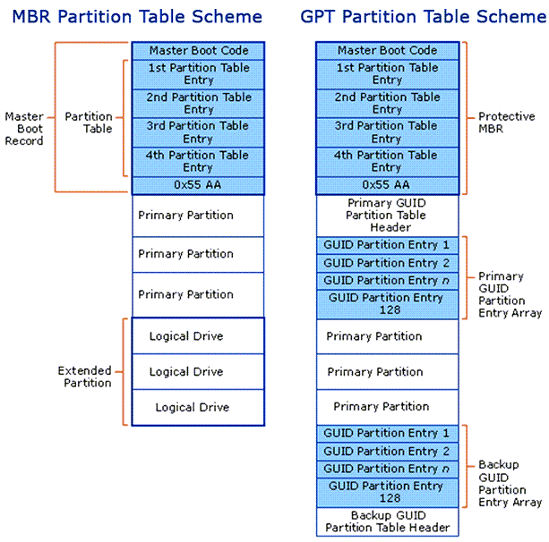

# GPT (GUID Partition Table)

The GUID Partition Table (GPT) is a partitioning scheme introduced as part of the **UEFI** (Unified Extensible Firmware Interface) standard to replace [MBR](04_mbr.md). While MBR stores partition information in a single 512-byte sector at the start of the disk, GPT uses a more robust structure that spans multiple sectors and includes built-in redundancy. Each partition is identified by a **GUID** (Globally Unique Identifier) — a 128-bit value that is virtually guaranteed to be unique across all disks and systems worldwide — which is where the name "GUID Partition Table" comes from.

GPT addresses the key limitations of MBR:

- **Disk size:** GPT uses 64-bit LBA addressing, supporting disks up to **9.4 ZB** (zettabytes) with 512-byte sectors — far beyond MBR's 2 TB limit.
- **Partition count:** GPT supports up to **128 partitions** by default (no need for extended/logical partitions).
- **Data integrity:** GPT stores CRC32 checksums for the header and partition table, allowing detection of corruption.
- **Redundancy:** GPT keeps a **backup copy** of the header and partition table at the end of the disk, so data can be recovered if the primary copy is damaged.
- **Backward compatibility:** GPT includes a **Protective MBR** in sector 0, which prevents older MBR-only tools from misinterpreting the disk as empty or unformatted.



## GPT Disk Layout

A GPT disk is organized into the following regions:

| Sector       | Component                                 | Size                            |
|--------------|-------------------------------------------|---------------------------------|
| LBA 0        | Protective MBR (for legacy compatibility) | 512 bytes (1 sector)            |
| LBA 1        | GPT Header                                | 92 bytes (aligned to 512 bytes) |
| LBA 2–33     | Primary Partition Entry Array             | 16,384 bytes (128 entries × 128 bytes) |
| LBA 34+      | User Data (Partitions)                    | Variable                        |
| Last sectors | Backup Partition Entry Array and GPT Header | Same as primary GPT           |

## GPT Header (LBA 1)

The GPT header contains metadata about the disk and the partition table itself:

| Field                       | Size     | Description                                                         |
|-----------------------------|----------|---------------------------------------------------------------------|
| Signature                   | 8 bytes  | ASCII string `"EFI PART"` (`0x45 0x46 0x49 0x20 0x50 0x41 0x52 0x54`). |
| Revision                    | 4 bytes  | GPT specification version (e.g., 1.0).                              |
| Header Size                 | 4 bytes  | Size of this header (92 bytes).                                     |
| Header CRC32                | 4 bytes  | Checksum for verifying header integrity.                            |
| Reserved                    | 4 bytes  | Must be zero.                                                       |
| Current LBA                 | 8 bytes  | LBA address of this header.                                         |
| Backup LBA                  | 8 bytes  | LBA address of the backup header (at the end of the disk).          |
| First Usable LBA            | 8 bytes  | First sector available for partition data.                          |
| Last Usable LBA             | 8 bytes  | Last sector available for partition data.                           |
| Disk GUID                   | 16 bytes | Unique identifier for the entire disk.                              |
| Partition Table Start LBA   | 8 bytes  | Starting LBA of the partition entry array.                          |
| Number of Partition Entries | 4 bytes  | Total number of entries in the partition table (default: 128).      |
| Size of Partition Entry     | 4 bytes  | Size of each entry (default: 128 bytes).                            |
| Partition Table CRC32       | 4 bytes  | Checksum for verifying the partition entry array.                   |

## Partition Entry (LBA 2–33)

Each partition entry is 128 bytes and describes a single partition:

| Field                  | Size     | Description                                          |
|------------------------|----------|------------------------------------------------------|
| Partition Type GUID    | 16 bytes | Identifies the purpose/type of the partition.        |
| Unique Partition GUID  | 16 bytes | Unique identifier for this specific partition.       |
| Starting LBA           | 8 bytes  | First sector of the partition.                       |
| Ending LBA             | 8 bytes  | Last sector of the partition.                        |
| Attributes             | 8 bytes  | Flags (e.g., read-only, hidden, system-required).    |
| Partition Name         | 72 bytes | Human-readable name, UTF-16 encoded.                 |

## Common Partition Type GUIDs

The **Partition Type GUID** identifies what the partition is used for. Below are the most common types:

| Partition Type                     | GUID                                 | Description                                          |
|------------------------------------|--------------------------------------|------------------------------------------------------|
| Unused Entry                       | `00000000-0000-0000-0000-000000000000` | Marks an empty slot in the partition table.        |
| EFI System Partition (ESP)         | `C12A7328-F81F-11D2-BA4B-00A0C93EC93B` | Stores UEFI bootloaders and system files.          |
| BIOS Boot Partition                | `21686148-6449-6E6F-744E-656564454649` | Used for BIOS bootloaders on GPT disks.            |
| Microsoft Reserved (MSR)           | `E3C9E316-0B5C-4DB8-817D-F92DF00215AE` | Reserved by Windows for internal use.              |
| Basic Data Partition               | `EBD0A0A2-B9E5-4433-87C0-68B6B72699C7` | Standard data partition (NTFS, FAT32, exFAT).      |
| Windows Recovery Environment       | `DE94BBA4-06D1-4D40-A16A-BFD50179D6AC` | Stores Windows recovery tools.                     |
| Linux Filesystem                   | `0FC63DAF-8483-4772-8E79-3D69D8477DE4` | Generic Linux filesystems (ext4, xfs, etc.).       |
| Linux Swap                         | `0657FD6D-A4AB-43C4-84E5-0933C84B4F4F` | Linux swap partitions.                             |
| Linux LVM                          | `E6D6D379-F507-44C2-A23C-238F2A3DF928` | Linux Logical Volume Manager partitions.           |
| Apple APFS                         | `7C3457EF-0000-11AA-AA11-00306543ECAC` | Apple APFS formatted partitions.                   |
| Apple HFS+                         | `48465300-0000-11AA-AA11-00306543ECAC` | Apple HFS+ formatted partitions.                   |

## How the OS Sees GPT Partitions

The operating system sees GPT partitions the same way it sees MBR partitions — Linux creates device files under `/dev/`, and Windows lists them in Disk Management. For device naming conventions, see [How the OS Sees MBR Partitions](04_mbr.md#how-the-os-sees-mbr-partitions).

The key behavioral differences from MBR:

- **No primary, extended, or logical distinction** — every GPT partition is equal.
- **No active flag** — UEFI firmware locates the EFI System Partition by its partition type GUID instead.
- **No 4-partition limit** — GPT supports up to 128 partitions by default.

> **Note:** Partitions are only structural — they define boundaries on the disk but contain no filesystem and cannot store data. Each partition must be formatted with a **filesystem** (such as FAT32, NTFS, or ext4) before it can be used. Filesystems are covered in [File Systems →](08_file_systems.md).

## GPT Partition Numbering in Linux

GPT partition numbering is straightforward — partitions are numbered **sequentially starting from 1** (`/dev/sda1`, `/dev/sda2`, …). Unlike [MBR](04_mbr.md#how-the-os-sees-mbr-partitions), there are no reserved numbers and no gaps because GPT has no concept of primary, extended, or logical partitions.

For example, a GPT disk with three partitions:

```
$ lsblk /dev/sda
NAME   SIZE  TYPE
sda    400G  disk
├─sda1   1M  part
├─sda2   2G  part
└─sda3 398G  part
```

[← Previous: MBR](04_mbr.md) | [Next: LVM →](06_lvm.md)
