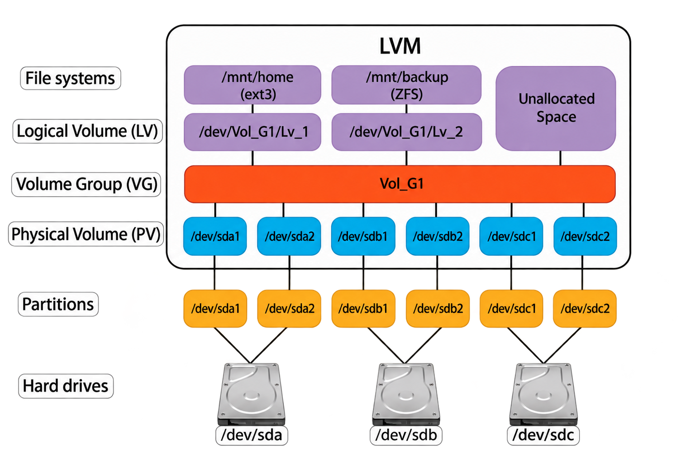

# LVM (Logical Volume Manager)

In the previous sections, we covered how disks are divided into partitions using [MBR](04_mbr.md) or [GPT](05_gpt.md). With traditional partitioning, each partition has a fixed size that is set at creation time. If a partition runs out of space, you cannot easily grow it — you would have to delete partitions, recreate them with different sizes, and restore data.

**LVM** (Logical Volume Manager) is an optional abstraction layer that sits between physical storage and filesystems. It allows you to resize, combine, and reorganize storage volumes without being locked to fixed partition boundaries. LVM does not replace MBR or GPT partitioning — it operates on top of existing block devices (partitions or whole disks).

## The Three Layers

LVM organizes storage into three layers. Each layer builds on the one below it:

### Physical Volume (PV)

A **Physical Volume** is a block device that has been initialized for LVM use. This can be a disk partition or an entire disk.

- Created with `pvcreate` (e.g., `pvcreate /dev/sda3` for a partition, or `pvcreate /dev/sdb` for a whole disk).

- When using a partition, the partition type should be set to `8E` (Linux LVM) on [MBR](04_mbr.md#partition-type-codes) disks, or the Linux LVM GUID on [GPT](05_gpt.md#common-partition-type-guids) disks. This is not required by LVM itself, but helps system administrators and partitioning tools identify the partition's purpose.

- When using a whole disk, no partition table is needed — LVM writes its own label directly to the device. Red Hat recommends creating a single partition spanning the entire disk for administrative clarity, but using the raw disk is fully supported.

### Volume Group (VG)

A **Volume Group** is a storage pool created by combining one or more PVs. Once PVs are added to a VG, their individual identities no longer matter — the VG treats all the space as one continuous pool.

- Created with `vgcreate`.
- A VG can span multiple physical disks. For example, two 500 GB drives can form a single 1 TB volume group.
- Internally, the VG divides its space into small equal-sized chunks called **Physical Extents** (PEs), typically 4 MiB each.

### Logical Volume (LV)

A **Logical Volume** is a virtual partition carved out of a VG. This is what you actually format with a filesystem and mount. From the operating system's perspective, an LV behaves exactly like a regular partition.

- Created with `lvcreate`.
- Can be resized after creation — grown with `lvextend` or shrunk with `lvreduce`.
- Multiple LVs can coexist in the same VG, and you do not need to allocate all the space in the VG upfront.

## How the Layers Connect

Without LVM, a block device (partition or disk) is formatted directly with a filesystem. With LVM, the three layers sit between the block device and the filesystem. The following diagram shows a multi-disk example:



Here, three hard drives (`/dev/sda`, `/dev/sdb`, `/dev/sdc`) are each partitioned into two parts. All six partitions are initialized as Physical Volumes and combined into a single Volume Group (`Vol_G1`). From that pool, two Logical Volumes are created — one formatted with ext3 and mounted at `/mnt/home`, the other formatted with ZFS and mounted at `/mnt/backup`. The remaining space in the VG is unallocated and available for future use.

This illustrates LVM's key strength: storage from multiple physical disks is merged into one flexible pool, and logical volumes can be created, resized, or added without being tied to any single disk's partition boundaries.

## Device Naming

LVM creates device files under two paths. Both are symlinks to the same underlying kernel device (`/dev/dm-N`):

| Path                    | Example                | Description |
|-------------------------|------------------------|-------------|
| `/dev/<vg>/<lv>`        | `/dev/vg0/root`        | LVM-specific symlink. Recommended for scripts and `/etc/fstab`. |
| `/dev/mapper/<vg>-<lv>` | `/dev/mapper/vg0-root` | Device-mapper symlink. Used by all device-mapper devices (LVM, LUKS, etc.). |

Both paths point to `/dev/dm-N` (e.g., `/dev/dm-0`), which is the actual block device node created by the kernel. Never use `/dev/dm-N` directly — the number can change between reboots. Use either of the stable symlink paths instead.

For example, consider a typical single-disk setup where one partition holds all the LVM volumes:

```
$ lsblk /dev/sda
NAME          SIZE  TYPE  MOUNTPOINTS
sda           100G  disk
├─sda1        512M  part  /boot/efi
├─sda2          2G  part  /boot
└─sda3       97.5G  part
  ├─vg0-root   30G  lvm   /
  ├─vg0-home   60G  lvm   /home
  └─vg0-swap    4G  lvm   [SWAP]
```

Notice that `sda3` has no mount point — it is a container for the LV devices, which are mounted individually.

## Basic Commands

The commands follow a consistent naming pattern — `pv*` for Physical Volumes, `vg*` for Volume Groups, and `lv*` for Logical Volumes:

| Step | Command | What it does |
|------|---------|-------------|
| 1. Create PV | `pvcreate /dev/sda3` | Initializes the block device for LVM use. |
| 2. Create VG | `vgcreate vg0 /dev/sda3` | Creates a volume group named `vg0` from the PV. |
| 3. Create LVs | `lvcreate -L 30G -n root vg0` | Creates a 30 GB logical volume named `root` in `vg0`. |
| | `lvcreate -L 60G -n home vg0` | Creates a 60 GB logical volume named `home` in `vg0`. |
| | `lvcreate -L 4G -n swap vg0` | Creates a 4 GB logical volume named `swap` in `vg0`. |
| 4. Format | `mkfs.ext4 /dev/vg0/root` | Creates the filesystem on the logical volume. |
| 5. Mount | `mount /dev/vg0/root /` | Mounts the logical volume. |

### Resizing — The Key Advantage

The main reason to use LVM is the ability to resize volumes after creation:

| Command | What it does |
|---------|-------------|
| `lvextend -L +20G /dev/vg0/home` | Grows `/home` by 20 GB. |
| `resize2fs /dev/vg0/home` | Expands the ext4 filesystem to fill the new space. |
| `lvextend -r -L +20G /dev/vg0/home` | Does both in one step (`-r` resizes the filesystem automatically). |

Shrinking works similarly with `lvreduce`, but the filesystem must be shrunk first (and some filesystems like XFS cannot be shrunk at all).

### Inspection Commands

| Command | What it shows |
|---------|-------------|
| `pvs` | Lists all Physical Volumes. |
| `vgs` | Lists all Volume Groups with total and free space. |
| `lvs` | Lists all Logical Volumes with their sizes. |
| `pvdisplay`, `vgdisplay`, `lvdisplay` | Detailed information about each layer. |

## When to Use LVM

| Situation | Use LVM? | Reason |
|-----------|----------|--------|
| Desktop, single user, simple setup | No | Plain partitions are simpler and sufficient. |
| Server where storage needs may change | Yes | Resize volumes without downtime or data migration. |
| Multiple disks that should act as one pool | Yes | A VG can span multiple physical disks. |
| Need snapshots for backups or testing | Yes | LVM supports point-in-time snapshots of logical volumes. |
| Full-disk encryption (LUKS) | Often | LVM and LUKS are commonly layered together in either order. |

For how LVM volumes appear in real-world partition layouts, see [Partition Layouts →](07_partition_layout.md).

[← Previous: GPT](05_gpt.md) | [Next: Partition Layouts →](07_partition_layout.md)
