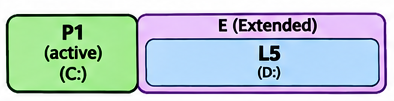
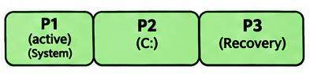
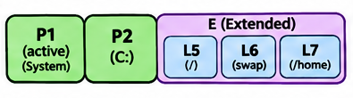
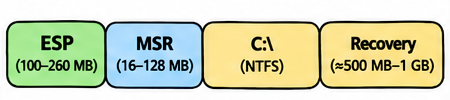
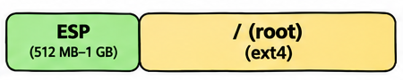
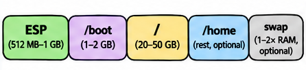
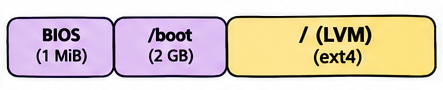
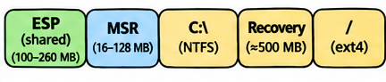

# Partition Layout

The previous sections covered the partitioning schemes ([MBR](04_mbr.md), [GPT](05_gpt.md)) and the optional volume management layer ([LVM](06_lvm.md)). This section shows how operating systems and installers combine those building blocks into real partition layouts — from simple single-partition setups to multi-disk server configurations.

## Partition Purposes

Before looking at specific layouts, here is what each common partition does:

- **Root (`/`)** — the base operating system. Contains system binaries, configuration files, libraries, and the directory structure defined by the [FHS](14_filesystem_hierarchy.md). This is the first partition [mounted](15_mounting.md) during boot, and all other partitions are mounted into this tree.

- **Home (`/home`)** — user files such as documents, downloads, and personal settings. A separate `/home` partition allows reinstalling the OS (by reformatting `/`) without losing user data. It also prevents a user filling their home directory from consuming all disk space on `/`.

- **Swap** — used by the kernel as overflow when physical RAM is full, and as storage for memory contents during hibernation. A dedicated swap **partition** is preferred over a swap file when hibernation is needed. Many modern distributions use a swap **file** inside the root partition instead.

- **Boot (`/boot`)** — stores the Linux kernel (`vmlinuz`), initial RAM filesystem (`initramfs`), and bootloader configuration. If root is a plain partition, `/boot` can stay inside it. A separate `/boot` partition is recommended when root uses [LVM](06_lvm.md), full-disk encryption (LUKS), or software RAID for the following reasons:

    - **Limited GRUB support** — GRUB 2 has built-in modules for LVM, LUKS, and RAID, but they only handle basic configurations. Advanced features like thin provisioning, cache volumes (writeback mode), and certain RAID setups are not supported or unreliable.
    - **UEFI firmware cannot read LVM** — the EFI System Partition (ESP) must always be a plain FAT32 partition that the firmware can access directly.
    - **Encryption adds complexity** — when LVM is layered on top of LUKS (or vice versa), GRUB must decrypt before it can read LVM. Keeping `/boot` outside both layers avoids this chain of dependencies.
    - **Easier recovery** — a plain `/boot` partition can be read by any live environment without activating LVM, making rescue operations simpler.

- **EFI System Partition (ESP)** — stores UEFI bootloader executables (`.efi` files). The UEFI firmware reads this partition directly to find and launch the bootloader. Formatted as FAT32, typically 100 MB–1 GB.

- **BIOS Boot Partition** — a small (1 MiB) unformatted partition used on BIOS + GPT systems. GRUB stores its core image (`core.img`) here because GPT does not guarantee the unused gap between sector 0 and the first partition that GRUB relies on with MBR.

- **Microsoft Reserved (MSR)** — a small partition (16 MB on Windows 10/11, 128 MB on Windows 8) reserved for Windows internal disk management. Contains no data and has no drive letter.

## Common MBR Partition Layouts

The four MBR partition table entries can be arranged in several ways. Below are the layouts that operating systems and installers have created in practice on BIOS + MBR systems.

| Layout                              | Slots Used |
|-------------------------------------|------------|
| One primary                         | P1 (active) |
| One primary + one extended          | P1 (active) + E → L5 |
| Two primaries                       | P1 (active) + P2 |
| Three primaries                     | P1 (active) + P2 + P3 |
| Two–three primaries + one extended  | P1 (active) + P2 + E → L5, L6, … |
| Four primaries                      | P1 + P2 + P3 + P4 |

### One Primary

The simplest layout — a single partition that spans the entire disk.

| Entry | Type | Purpose |
|-------|------|---------|
| 1 | Primary (active) | OS and data |

**Systems:**
- **MS-DOS 2.0–3.0** — these early versions had no extended partition support. FDISK created a single primary partition, and that was the only partition on the disk.
- **Windows XP** — a clean install on an empty disk created a single NTFS primary partition (C:). Windows XP had no System Reserved partition; all boot files lived on C: alongside the OS.
- **Bootable USB sticks** — tools like Rufus ("MBR" mode) create one FAT32 primary partition that holds everything.
- **Ubuntu 17.04+** — starting with version 17.04, the Ubuntu installer uses a swap file inside the root filesystem instead of a separate swap partition, so a fresh BIOS install is often just one primary partition.

### One Primary + One Extended

The classic DOS/Windows layout. Starting with MS-DOS 3.3, `FDISK` supported extended partitions but would only create one primary DOS partition per disk. To get additional drives (D:, E:, …), you created an extended partition with logical partitions inside it.

| Entry | Type | Purpose |
|-------|------|---------|
| 1 | Primary (active) | C: — OS and boot files |
| 2 | Extended | Container |
| 5 | Logical | D: — data |

**Systems:**
- **MS-DOS 3.3–6.22, Windows 3.x, Windows 95/98/ME** — `FDISK` enforced this pattern: one primary for C:, one extended with logical drives for D: and beyond.
- **Windows XP (with data drives)** — XP's Disk Management allowed up to three primaries before requiring an extended partition, but OEM setups and home PCs commonly used the one-primary-plus-extended pattern: C: primary for the OS, D: logical for data.
- **Ubuntu/Mint before 17.04** — the Linux version of the same pattern: one primary for `/` (root), one logical for swap.

### Two Primaries

Starting with Windows 7, the installer creates a hidden "System Reserved" partition alongside the main OS partition.

| Entry | Type | Size | Purpose |
|-------|------|------|---------|
| 1 | Primary (active) | 100 MB (Win 7), 350 MB (Win 8/8.1), 500 MB (Win 10) | System Reserved — boot manager (`bootmgr`), boot configuration (BCD), and WinRE (Win 8+) |
| 2 | Primary | Rest of disk | C: — Windows |

The System Reserved partition must be primary and active because the MBR bootstrap code can only boot from a [primary partition](04_mbr.md#active-partition). On Windows 8 and later, the System Reserved partition also contains the Windows Recovery Environment (WinRE), which is why its size grew from 100 MB to 350 MB and then 500 MB. If you install onto a disk that already has partitions, Setup may skip System Reserved and put the boot files on C: itself.

**Systems:**
- **Windows 7** — 100 MB System Reserved (boot files only; WinRE stored on C:).
- **Windows 8/8.1** — 350 MB System Reserved (boot files + WinRE).
- **Windows 10** — 500 MB System Reserved (boot files + WinRE).
- **RHEL/CentOS 6–7** — a similar two-primary layout on the Linux side: a small `/boot` partition (ext4 or xfs, 500 MB–1 GB) and a large [LVM](06_lvm.md) partition containing root, swap, and `/home` as logical volumes.

### Three Primaries

On MBR, the Windows 10 clean install creates only two partitions (System Reserved + C:) with WinRE inside System Reserved. A separate recovery partition appears in two scenarios:

| Entry | Type | Size | Purpose |
|-------|------|------|---------|
| 1 | Primary (active) | 100–500 MB | System Reserved (boot files) |
| 2 | Primary | Rest of disk | C: — Windows |
| 3 | Primary | ~450–650 MB | Recovery (WinRE) |

**Systems:**
- **OEM and enterprise deployments** — Microsoft recommends a separate recovery partition immediately after C: so that future updates can resize it. OEMs use DiskPart scripts during image deployment to create this layout.
- **Windows 10 feature upgrades** — when upgrading to a new Windows 10 version (e.g., 1607, 1703, 1809), the upgrade process may shrink C: and carve out a new recovery partition if the existing WinRE location cannot accommodate the updated recovery image.

### Two–Three Primaries + One Extended (Dual Boot)

When Windows already occupies 2–3 primary entries, Linux goes into logical partitions inside an extended partition.

| Entry | Type | Purpose |
|-------|------|---------|
| 1 | Primary (active) | System Reserved (Windows boot files) |
| 2 | Primary | C: — Windows |
| 3 | Extended | Container for Linux |
| 5 | Logical | `/` — Linux root (ext4) |
| 6 | Logical | Linux swap |
| 7 | Logical | `/home` — Linux user files (ext4) |

**Systems:** Any Windows + Linux dual boot on BIOS + MBR (e.g., Windows 7/10 alongside Ubuntu, Fedora, or Debian). This is the main reason logical partitions were common in the Linux world — not because Linux needed them, but because Windows had already taken the primary slots. Linux's bootloader (GRUB) can boot from any partition type, including logical partitions. In a dual-boot setup, GRUB replaces the Windows MBR bootstrap code and presents a menu that can chain-load either OS.

> **Note:** Some older BIOSes refuse to boot a disk unless at least one partition is marked active, even though GRUB ignores the active flag entirely. This is why Linux installers still set the boot flag on MBR disks.

### Four Primaries

All four slots used for primary partitions, with no extended partition. This limits the disk to exactly four partitions with no way to add more.

**Systems:** Rare in practice. Occasionally seen on manually partitioned disks where exactly four volumes are needed and no future expansion is expected.

## Common GPT Partition Layouts

Below are the layouts that operating systems and installers create on GPT disks.

| Layout | Partitions | Systems |
|--------|-----------|---------|
| ESP + MSR + C: + Recovery | 4 | Windows 10/11 (UEFI) |
| ESP + root | 2 | Ubuntu Desktop, Arch Linux (small disks) |
| ESP + `/boot` + root (+ `/home` + swap) | 3–5 | Ubuntu Server, RHEL, Debian, Arch Linux (≥64 GiB disks, with LVM or separate partitions) |
| ESP + `/boot` + btrfs root | 3 | Fedora Workstation |
| BIOS boot + `/boot` + LVM root | 3 | Linux on BIOS + GPT (VMs, servers >2 TB) |
| Shared ESP + Windows + Linux | 5+ | Windows + Linux dual boot (UEFI) |

### Windows 10/11 (UEFI + GPT)

The default layout for modern Windows.

| # | Partition | Size | Filesystem | Purpose |
|---|-----------|------|------------|---------|
| 1 | ESP | 100 MB (260 MB on 4K-native drives) | FAT32 | Boot manager (`bootmgfw.efi`) and boot configuration (BCD) |
| 2 | MSR | 16 MB (128 MB on Win 7/8/8.1) | None | Reserved for Windows internal use |
| 3 | C: | Rest of disk | NTFS | Windows, programs, user files |
| 4 | Recovery | ~500 MB–1 GB | NTFS | Windows Recovery Environment (WinRE) |

**Systems:** Windows 10 (2004+) and Windows 11 clean installs. Older Windows 10 builds (before version 2004) placed the Recovery partition *first* (~450 MB); you will still see that layout on upgraded machines.

> **Note — Microsoft's confusing vocabulary:** Microsoft calls the ESP the "system partition" and the C: drive the "boot partition" — the opposite of what the names suggest. The "system" partition is where *booting starts*, and the "boot" partition is where the *OS lives*. This naming dates back to Windows NT and is visible in Disk Management and `diskpart`.

### Linux — UEFI + GPT

The default for modern Linux installations. The exact layout depends on the distribution.

**Minimal layout (2 partitions)** — used when root is a plain partition (no LVM, no encryption):

| # | Partition | Size | Filesystem | Purpose |
|---|-----------|------|------------|---------|
| 1 | ESP | 512 MB–1 GB | FAT32 | UEFI bootloader files |
| 2 | Root (`/`) | Rest of disk | ext4 | Entire OS, user files, swap file |

**Systems:** Ubuntu Desktop 24.04 (swap file), Arch Linux (archinstall, small disks only — on disks ≥64 GiB archinstall creates a separate `/home`, see expanded layout).

**Expanded layout (3+ partitions)** — used when root is on LVM, encrypted, or when you want separate partitions:

| # | Partition | Size | Filesystem | Purpose |
|---|-----------|------|------------|---------|
| 1 | ESP | 512 MB–1 GB | FAT32 | UEFI bootloader files |
| 2 | `/boot` | 1–2 GB | ext4 | Kernel and bootloader config |
| 3 | Root (`/`) | 20–50 GB | ext4 | OS and installed software |
| 4 | `/home` | Remainder | ext4 | User files and settings |
| 5 | Swap | 1–2× RAM | swap | Virtual memory and hibernation |

**Systems:** RHEL (recommended layout, full expanded), Ubuntu Server (LVM, swap file), Debian (guided install — simple mode creates ESP + root + swap partition; separate `/home` mode adds a fourth partition), Arch Linux (archinstall on disks ≥64 GiB, root capped at 50 GB with separate `/home`).

**Fedora layout (btrfs subvolumes):**

| # | Partition | Size | Filesystem | Purpose |
|---|-----------|------|------------|---------|
| 1 | ESP | 600 MiB | FAT32 | UEFI bootloader files |
| 2 | `/boot` | 2 GiB | ext4 | Kernel (GRUB cannot reliably read btrfs) |
| 3 | Root | Rest of disk | btrfs | `/` and `/home` as subvolumes |

**Systems:** Fedora Workstation 43+. Earlier versions used 1 GiB for `/boot`.

The trend across distributions is toward simpler defaults — a root partition with a swap file — and leaving expanded layouts for manual configuration or enterprise use.

### Linux — BIOS + GPT

When Linux runs on a BIOS machine with a GPT disk (common in VMs and servers with disks >2 TB), the ESP is replaced by a **BIOS boot partition**.

| # | Partition | Size | Type | Purpose |
|---|-----------|------|------|---------|
| 1 | BIOS boot | 1 MiB | `EF02` (no filesystem) | GRUB core image (`core.img`) |
| 2 | `/boot` | 2 GB | ext4 | Kernel and bootloader config |
| 3 | Root | Rest of disk | LVM → ext4 | OS and data |

**Systems:** Ubuntu Server on BIOS machines, QEMU/KVM and Proxmox VMs (which default to SeaBIOS), and servers with disks larger than 2 TB. The BIOS boot partition has nothing to do with `/boot` — never format or mount it. Windows cannot boot from this layout.

### Dual Boot — Windows + Linux (UEFI + GPT)

Linux reuses the existing Windows ESP — both OSes keep their bootloader files side by side in separate folders.

| # | Partition | Filesystem | Purpose |
|---|-----------|------------|---------|
| 1 | ESP (shared) | FAT32 | `\EFI\Microsoft\...` and `\EFI\ubuntu\...` |
| 2 | MSR | None | Windows reserved |
| 3 | C: (shrunk) | NTFS | Windows |
| 4 | Recovery | NTFS | WinRE |
| 5 | Linux root | ext4 | `/` |

**Systems:** Any Windows + Linux dual boot on UEFI + GPT (e.g., Windows 11 alongside Ubuntu or Fedora). GRUB presents a boot menu that can chain-load Windows Boot Manager from the shared ESP.

These partitions are connected into a single directory tree through [mounting](15_mounting.md).

[← Previous: LVM](06_lvm.md) | [Next: File Systems →](08_file_systems.md)

