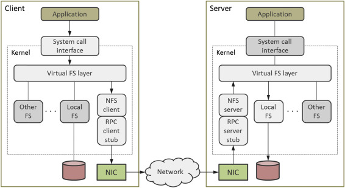

# File Systems

In the previous sections, we covered how a disk is divided into partitions using [MBR](04_mbr.md) or [GPT](05_gpt.md). However, a freshly created partition is just a reserved range of sectors — it has no structure and cannot store files yet.

To make a partition usable, it must be **formatted**. Formatting is the process of writing a **filesystem** onto a partition. This creates the internal data structures (directories, allocation tables, metadata) that the operating system needs to organize, store, and retrieve files.

In short: **partitioning** divides the disk → **formatting** writes a filesystem → the partition is ready to use.

## Filesystem Classes

Filesystems can be grouped by their design purpose and target environment:

### Traditional (Local) Filesystems

The most common type — designed for day-to-day file storage on a single block device (a disk, partition, or logical volume). These filesystems use **in-place updates**: when a file is modified, the existing data on disk is overwritten directly. Most use [journaling](#journaling) to protect against corruption from crashes during writes.

| **Filesystem** | **Year** | **Creator**            | **OS**                     | **Max File Size**  | **Max Volume Size**  |
|----------------|----------|------------------------|----------------------------|--------------------|----------------------|
| FAT12          | 1980     | SCP, Microsoft         | MS-DOS, Windows            | 16 MB              | 16 MB                |
| FAT16          | 1984     | IBM, Microsoft         | MS-DOS, Windows            | 4 GB               | 2 GB                 |
| HFS            | 1985     | Apple                  | Classic Mac OS             | 2 GB               | 2 TB                 |
| HPFS           | 1989     | Microsoft/IBM          | OS/2                       | 2 GB               | 2 TB                 |
| ext            | 1992     | Rémy Card              | Linux                      | 2 GB               | 2 GB                 |
| NTFS           | 1993     | Microsoft              | Windows NT and later       | 16 EB              | 16 EB                |
| ext2           | 1993     | Rémy Card              | Linux                      | 2 TB               | 16 TB                |
| XFS            | 1994     | SGI                    | Linux                      | 8 EB               | 8 EB                 |
| FAT32          | 1996     | Microsoft              | Windows, macOS, Linux      | 4 GB               | 2 TB                 |
| HFS+           | 1998     | Apple                  | macOS                      | 8 EB               | 8 EB                 |
| ext3           | 2001     | Stephen Tweedie        | Linux                      | 2 TB               | 16 TB                |
| exFAT          | 2006     | Microsoft              | Windows, macOS, Linux      | 128 PB             | 128 PB               |
| ext4           | 2006     | Theodore Ts'o et al.   | Linux                      | 16 TB              | 1 EB                 |

FAT, NTFS, and ext4 are covered in detail in docs [11 (FAT)](11_fat_filesystem.md), [12 (NTFS)](12_ntfs_filesystem.md), and [13 (ext4)](13_ext_filesystem.md). For a comprehensive comparison, see [Wikipedia — Comparison of file systems](https://en.wikipedia.org/wiki/Comparison_of_file_systems).

### Copy-on-Write (CoW) Filesystems

Like traditional filesystems, CoW filesystems store data on local block devices. The difference is in how writes are handled: **data is never overwritten in place**. Instead, modified data is written to a new location, and the old location is freed only after the new write is committed. This enables features that traditional filesystems cannot easily provide:

- **Snapshots** — instant point-in-time copies of the entire filesystem.
- **Checksums** — every block is checksummed, detecting silent corruption.
- **Pooled storage** — multiple devices can be managed as a single storage pool with built-in RAID.
- **Self-healing** — corrupted blocks can be automatically repaired from redundant copies.

The trade-off is **write amplification** — a single logical write may produce multiple physical writes as tree nodes are updated along the CoW path. The major CoW filesystems in use today:

| **Filesystem** | **Year** | **Creator**            | **OS**                     | **Max File Size**  | **Max Volume Size** |
|----------------|----------|------------------------|----------------------------|--------------------|----------------------|
| ZFS            | 2004     | Sun Microsystems       | Solaris, Linux, BSD        | 16 EB              | 16 EB                |
| Btrfs          | 2009     | Chris Mason            | Linux                      | 16 EB              | 16 EB                |
| APFS           | 2017     | Apple                  | macOS, iOS                 | 8 EB               | 8 EB                 |
| bcachefs       | 2023     | Kent Overstreet        | Linux                      | —                  | —                    |

> **Note:** bcachefs does not publish formal size limits. Its 64-bit addressing and "petabyte scalability" design suggest very large theoretical limits, but no official figures have been documented. Users are running it on 100 TB+ filesystems in production.

### Network Filesystems

A network filesystem acts as a client for a remote file-access protocol. Files live on a remote server, but applications on the local machine access them transparently through the same system calls (`open`, `read`, `write`) as local files. The [VFS](13_ext_filesystem.md#virtual-file-system-vfs) layer dispatches operations to the network filesystem driver, which translates them into remote procedure calls over the network.

The diagram below shows this flow using NFS as an example. On the client side, an application calls `open()` or `read()`, which passes through the VFS layer to the NFS client driver. The driver translates the operation into an RPC (Remote Procedure Call) sent over the network. On the server side, the NFS server receives the RPC, performs the operation on its local filesystem, and returns the result.



Although the diagram uses NFS, the same client–server model applies to all network filesystem protocols:

| **Protocol** | **Year** | **Creator**            | **Current Version** | **Primary Use Case**                    | **Encryption**            |
|--------------|----------|------------------------|---------------------|-----------------------------------------|---------------------------|
| SMB          | 1983     | IBM (Barry Feigenbaum) | SMB 3.1.1 (2015)    | Windows, mixed-OS, NAS                  | Built-in (SMB 3.0+)      |
| NFS          | 1984     | Sun Microsystems       | NFSv4.2 (2016)      | Linux/Unix, HPC, VM/container storage   | Optional (Kerberos/VPN)   |
| AFS          | 1984     | Carnegie Mellon Univ.  | OpenAFS 1.8         | Universities, labs (CERN, MIT)          | Kerberos                  |
| AFP          | 1988     | Apple                  | AFP 3.4             | macOS (legacy, replaced by SMB)         | Optional                  |
| 9P           | 1992     | Bell Labs (Plan 9)     | 9P2000              | VM/container file sharing (QEMU, WSL)   | None built-in             |
| CIFS         | 1996     | Microsoft              | (merged into SMB 2+) | Rebranded SMB for Windows environments  | —                         |
| SSHFS        | 2004     | Miklos Szeredi (FUSE)  | via SFTP/SSH        | Ad-hoc remote access, encrypted mounts  | Always (SSH)              |
| Amazon EFS   | 2016     | AWS                    | NFSv4.1             | Managed cloud NAS (scalable, serverless)| Encryption at rest + transit |

### Distributed Filesystems

Similar to network filesystems, but data is spread across **multiple nodes** in a cluster rather than stored on a single server. The cluster coordinates to present a single unified namespace to clients. Different implementations take different approaches — some use dedicated metadata servers (Lustre, CephFS, HDFS), others distribute metadata across all nodes (GlusterFS), and some use shared-disk access with a distributed lock manager (GFS2). For a detailed explanation of these approaches, see [Storage Types — Distributed Filesystems](01_storage.md#distributed-filesystems).

| **Filesystem**                        | **Year** | **Description**                                                            |
| ------------------------------------- | -------- | -------------------------------------------------------------------------- |
| DCE/DFS (Distributed File System)     | 1991     | Developed by Transarc as part of OSF's Distributed Computing Environment. |
| GFS (Global File System)              | 1996     | A shared-disk filesystem developed at the University of Minnesota; later acquired by Red Hat. |
| Lustre                                | 2003     | A high-performance parallel filesystem for large-scale cluster computing.  |
| GlusterFS                             | 2006     | A scalable distributed filesystem for cloud and containerized environments.|
| CephFS                                | 2006     | A distributed filesystem built on top of the Ceph storage platform.        |
| HDFS (Hadoop Distributed File System) | 2006     | Built for big data processing within the Hadoop ecosystem.                 |

These filesystems are built to handle **petabyte-scale data** and tolerate node failures without service interruption, using mechanisms like replication, erasure coding, and automatic data rebalancing.

### Virtual / Pseudo Filesystems

Kernel-backed filesystems that exist **only in memory** — they have no on-disk storage. Instead, they expose kernel data structures, hardware information, or temporary storage as files and directories. They are created fresh on every boot and consume no disk space.

**Examples:** procfs (`/proc`), sysfs (`/sys`), devtmpfs (`/dev`), tmpfs. See [Mounting — Step 2: Virtual Filesystems](15_mounting.md#step-2-virtual-filesystems) for how these are mounted during boot.

### Flash-Optimized Filesystems

Designed for NAND flash memory, which has different characteristics than spinning disks — notably erase-before-write requirements, limited write cycles per cell, and the need for wear leveling. There are two subcategories:

- **Raw-flash filesystems** — manage the flash hardware directly, without a Flash Translation Layer (FTL). Used in embedded systems where the OS talks to bare NAND chips. Examples: **JFFS2**, **UBIFS**.
- **FTL-aware filesystems** — designed for flash devices that have a built-in FTL (SSDs, eMMC, SD cards). They optimize for the sequential-write patterns that flash controllers prefer. Example: **F2FS**.

### Overlay Filesystems

Overlay filesystems combine multiple directory trees into a **single merged view**. A typical setup layers a writable upper directory on top of a read-only lower directory. Reads fall through to the lower layer; writes go to the upper layer (copy-on-write at the file level). This is the foundation of container image layers.

**Examples:** OverlayFS (used by Docker and container runtimes). See [OverlayFS](https://github.com/ManiAm/primer-virtualization/blob/master/docs/24_docker_image.md#how-it-works-overlayfs) for a detailed walkthrough of Docker's use of OverlayFS.

### Optical Filesystems

Filesystems designed for read-only or write-once media such as CDs, DVDs, and Blu-ray discs.

**Examples:** ISO 9660, UDF.

## Default Filesystems by Operating System

Each operating system has a default filesystem that it uses when formatting new storage:

| Operating System         | Default Filesystem            |
|--------------------------|-------------------------------|
| Linux (most distros)     | ext4                          |
| ChromeOS                 | ext4                          |
| Android                  | ext4 or F2FS                  |
| Windows (current)        | NTFS                          |
| Windows (older versions) | FAT32                         |
| macOS (current)          | APFS                          |
| macOS (older versions)   | HFS+                          |
| iOS                      | APFS                          |
| FreeBSD                  | UFS or ZFS                    |
| Solaris                  | ZFS                           |

## Hierarchical Structure

Nearly all modern filesystems organize data in a **hierarchical** (tree-like) structure:

- **Files** are the basic units of storage — they contain text, images, programs, or any other data.
- **Directories** (also called **folders** in GUI environments) are containers that hold files and other directories (subdirectories).

The topmost directory in the hierarchy is called the **root directory**:

- In Unix/Linux, the root directory is denoted as `/`.
- In Windows, each drive has its own root, denoted by a drive letter (e.g., `C:\`).

**Unix/Linux example:**

```
/
├── home/
│   └── user1/
│       ├── Documents/
│       ├── Downloads/
│       └── file.txt
└── var/
    ├── log/
    ├── www/
    └── cache/
```

**Windows example:**

```
C:\
├── Program Files\
├── Users\
│   └── John\
│       ├── Documents\
│       ├── Pictures\
│       └── report.docx
└── Windows\
    ├── System32\
    └── Logs\
```

> **Directory vs. Folder:** These terms refer to the same concept. "Directory" is the traditional term used in technical contexts, while "folder" was introduced with graphical user interfaces (GUIs) as a more visual, user-friendly label. In practice, they are interchangeable.

## Paths

The location of a file or directory within the hierarchy is called a **path**. A path describes how to navigate the tree structure to reach a specific file or directory.

Path components are separated by `/` (Unix/Linux) or `\` (Windows).

**Absolute path** — starts from the root directory and provides the full location:

```
Unix:    /home/user/file.txt
Windows: C:\Users\User\file.txt
```

**Relative path** — starts from the current directory and specifies the location relative to it:

```
../Documents/report.txt      (go up one level, then into Documents)
./config.yaml                (current directory)
```

## File Extensions

A **file extension** is a suffix at the end of a filename (e.g., `.txt`, `.jpg`, `.exe`) that identifies the file type. It tells the operating system or application what program to use to open or process the file.

How different operating systems handle extensions:

- **Windows** heavily depends on file extensions to determine file types and associated programs. Without a proper extension, Windows may not recognize how to open the file.

- **Unix/Linux** does not strictly rely on extensions. It can identify files by their content using **magic numbers** (signatures embedded within the file) and commands like `file`. Extensions are still used by convention but are not required.

- **macOS** uses file extensions but is less dependent on them compared to Windows. It also uses metadata to identify file types.

## Journaling

A **journaling filesystem** records changes in a separate structure called a **journal** (or log) before committing them to the main filesystem. If a system crash or power failure occurs mid-write, the journal can be used to recover incomplete changes — either completing them or rolling them back. This greatly reduces the risk of filesystem corruption and speeds up recovery.

There are two levels of journaling:

| Journaling Level     | What is Logged                | Reliability | Performance |
|----------------------|-------------------------------|-------------|-------------|
| **Metadata-only**    | Directory structures, file attributes, allocation tables | Good | Better (less write overhead) |
| **Full data + metadata** | All modified data blocks plus metadata | Higher | Lower (more writes) |

**Examples:**

- **NTFS** uses metadata-only journaling.
- **ext3/ext4** support both modes — metadata-only (default) or full data journaling (configurable).

Journaling is standard in all modern traditional filesystems. Older filesystems like FAT12/16/32 and ext2 do not have journaling, which is why they are more vulnerable to corruption after unexpected shutdowns.

> **Note:** [Copy-on-Write filesystems](#copy-on-write-cow-filesystems) (ZFS, Btrfs, APFS) do not use traditional journaling. They achieve crash consistency through CoW semantics — new data is always written to a new location, and the on-disk tree is updated atomically. This provides the same protection against corruption without a separate journal.

[← Previous: Partition Layout](07_partition_layout.md) | [Next: Disk Tools →](09_disk_tools.md)
