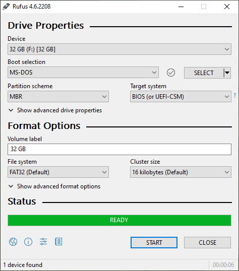

# Disk Tools

This section covers the tools used to create partitions and format them with filesystems. There are two distinct operations:

- **Partitioning** — dividing a disk into sections (partitions). Some tools only do this and have no formatting capability.
- **Formatting** — writing a filesystem (e.g., ext4, NTFS, FAT32) onto a partition so it can store data.

Many tools combine both operations. The table below lists widely used tools across operating systems:

| Tool                | Year | OS        | Type | Partitioning | Formatting Options                    |
|---------------------|------|-----------|------|--------------|---------------------------------------|
| mkfs                | 1979 | Unix-like | CLI  | No           | ext2/3/4, xfs, btrfs, FAT, NTFS       |
| Format              | 1981 | Windows   | CLI  | No           | NTFS, FAT32, exFAT                    |
| fdisk               | 1983 | Unix-like | CLI  | Yes          | No                                    |
| cfdisk              | 1994 | Unix-like | TUI  | Yes          | No                                    |
| GNU Parted          | 1999 | Linux     | CLI  | Yes          | ext4, NTFS, FAT32, swap               |
| Disk Management     | 2000 | Windows   | GUI  | Yes          | NTFS, FAT32, exFAT, ReFS              |
| Disk Utility        | 2001 | macOS     | GUI  | Yes          | APFS, HFS+, FAT32, exFAT              |
| DiskPart            | 2001 | Windows   | CLI  | Yes          | NTFS, FAT32, exFAT, ReFS              |
| GParted             | 2004 | Linux     | GUI  | Yes          | ext4, NTFS, FAT32, swap               |
| gdisk               | 2009 | Cross     | CLI  | Yes (GPT)    | No                                    |
| GNOME Disks         | 2009 | Linux     | GUI  | Yes          | ext4, NTFS, FAT32, exFAT              |
| Rufus               | 2011 | Windows   | GUI  | Yes          | NTFS, FAT32, exFAT (bootable USB)     |

> **Note:** Linux tools are typically CLI-based, offering flexibility and scriptability. Windows and macOS provide GUI tools for ease of use. Many Linux desktop environments also include GUI frontends (GParted, GNOME Disks, KDE Partition Manager).

## fdisk Utility

`fdisk` is a command-line utility for managing partition tables on a disk. It supports creating, deleting, resizing, and listing partitions. By default, `fdisk` works with **MBR** partition tables. For **GPT** disks, use `gdisk` instead.

> `cfdisk` provides the same functionality with a text-based visual interface (TUI), making it more beginner-friendly.

### Example: Partitioning a USB Drive

Launch fdisk on the target device:

```
$ sudo fdisk /dev/sdb
```

Common fdisk commands (interactive mode):

| Command | Action                          |
|---------|---------------------------------|
| `p`     | Print the current partition table |
| `n`     | Create a new partition          |
| `d`     | Delete a partition              |
| `t`     | Change a partition's type code  |
| `l`     | List known partition type codes |
| `w`     | Write changes to disk and exit  |
| `q`     | Quit without saving changes     |

After partitioning, the new partitions (e.g., `/dev/sdb1`, `/dev/sdb2`) are ready to be **formatted** with a filesystem using `mkfs`.

## mkfs Utility

`mkfs` (short for "make filesystem") is a command-line utility used to create a filesystem on a partition. It initializes the partition with the chosen filesystem structure, enabling the operating system to organize and manage files on it.

`mkfs` is actually a frontend — it calls filesystem-specific tools depending on the type requested:

| Command        | Filesystem          | Description                                      |
|----------------|---------------------|--------------------------------------------------|
| `mkfs.ext4`    | ext4                | The standard Linux filesystem.                   |
| `mkfs.ext3`    | ext3                | Older journaling Linux filesystem.               |
| `mkfs.ext2`    | ext2                | Legacy Linux filesystem (no journaling).         |
| `mkfs.fat`     | FAT12/16/32         | General-purpose FAT formatter (use `-F` flag to select variant). |
| `mkfs.vfat`    | FAT with VFAT (LFN) | Creates FAT filesystems with long filename support. |
| `mkfs.msdos`   | FAT (8.3 names)     | Legacy FAT with MS-DOS-style short filenames only. |
| `mkfs.ntfs`    | NTFS                | Windows NTFS filesystem (via `ntfs-3g`).         |
| `mkfs.btrfs`   | Btrfs               | Copy-on-write filesystem with snapshots.         |
| `mkfs.xfs`     | XFS                 | High-performance filesystem (default on RHEL).   |

### Example: Formatting a USB Drive

First, identify the device using `lsblk`:

```
$ lsblk

NAME   MAJ:MIN RM   SIZE RO TYPE MOUNTPOINT
sda      8:0    0 311.2G  0 disk
├─sda1   8:1    0   512M  0 part /boot/efi
├─sda2   8:2    0     1K  0 part
└─sda5   8:5    0 310.7G  0 part /
sdb      8:16   1  28.7G  0 disk
├─sdb1   8:17   1   255M  0 part /media/maniam/FAT12
├─sdb2   8:18   1     4G  0 part /media/maniam/FAT16
└─sdb3   8:19   1  24.4G  0 part /media/maniam/FAT32
```

If the partition is mounted, unmount it first:

```
$ sudo umount /dev/sdb1
```

Then format with the desired filesystem:

```
$ sudo mkfs.vfat -F 12 /dev/sdb1    # Format as FAT12
$ sudo mkfs.vfat -F 16 /dev/sdb2    # Format as FAT16
$ sudo mkfs.vfat -F 32 /dev/sdb3    # Format as FAT32
```

## Rufus Utility

Rufus is a free, lightweight Windows utility primarily used to create **bootable USB drives**. It is widely used for installing operating systems (Windows, Linux) and flashing firmware.



Key features:

- Supports both **MBR and GPT** partition schemes.
- Supports both **BIOS and UEFI** boot modes.
- Formats USB drives with FAT32, NTFS, exFAT, or UDF.
- Can write ISO images directly to USB for bootable installation media.
- Offers Secure Boot support and bad block checking.

## Hex Editors

Hex editors allow you to open physical drives in raw mode and inspect low-level disk structures such as the MBR, partition tables, and filesystem metadata byte by byte.

### ImHex

ImHex is an open-source hex editor designed for reverse engineering, data inspection, and binary file analysis. It supports pattern highlighting, data visualization, and custom data structure definitions.

To inspect a drive with ImHex:

1. Open ImHex as administrator.
2. Go to **File → Open Other → Raw Disk Provider**.
3. Select the drive or physical device.
4. The raw hexadecimal content of the disk is displayed.
5. Right-click on the **Pattern Editor** pane and select **Import Pattern File**.
6. Search for `fs` and open the **Drive File System** template to parse the raw data into labeled structures.

### 010 Editor

010 Editor is a professional hex and text editor developed by SweetScape Software. It is widely used by developers, reverse engineers, and forensic analysts for viewing and editing binary data.

Its standout feature is **Binary Templates** — scripts that parse binary data and display it as labeled, structured fields. This makes complex file formats (such as MBR, GPT, FAT, NTFS) much easier to understand and navigate.

010 Editor also supports large files, an integrated C-like scripting language, and tools for searching, replacing, and comparing binary data.

[← Previous: File Systems](08_file_systems.md) | [Next: Metadata →](10_metadata.md)

