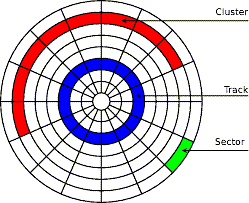
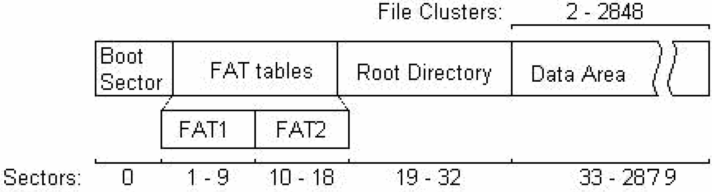
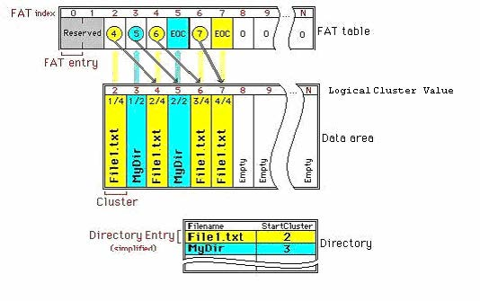
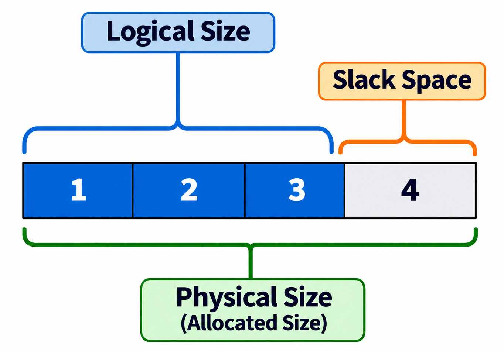
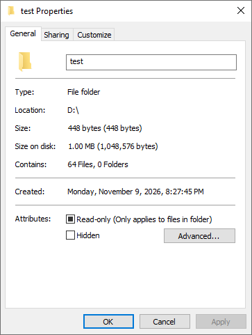
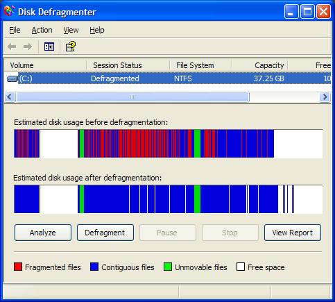

# FAT Filesystem

In the previous sections, we explored [filesystems](08_file_systems.md) in general, the [tools](09_disk_tools.md) used to manage them, and the [metadata](10_metadata.md) they store. Now we examine the first filesystem in detail: **FAT** (File Allocation Table).

FAT is one of the oldest and simplest filesystems. The original concept was devised by Microsoft in 1977, and the first implementation (FAT12) was created by Tim Paterson at Seattle Computer Products in 1980 for QDOS. Microsoft later adopted and extended it for MS-DOS and Windows. Despite its age, FAT remains widely used on USB drives, memory cards, and embedded systems due to its simplicity and universal cross-platform compatibility.

The FAT family includes several versions:

| Version | Year | Introduced With          | Max File Size | Max Volume Size | Max Filename Length | Purpose |
|---------|------|--------------------------|---------------|-----------------|---------------------|---------|
| FAT12   | 1980 | QDOS / PC DOS 1.0        | 16 MB         | 16 MB           | 8.3 format          | Floppy disks and very small media |
| FAT16   | 1984 | PC DOS 3.0 / MS-DOS 3.0  | 4 GB          | 4 GB            | 8.3 format          | Early hard drives and small storage |
| VFAT    | 1993 | Windows for Workgroups 3.11 | —          | —               | 255 characters      | Extension adding long filename support |
| FAT32   | 1996 | Windows 95 OSR2          | 4 GB          | 2 TB            | 255 characters      | USB drives, memory cards, larger volumes |
| exFAT   | 2006 | Windows CE 6.0           | 16 EB         | 128 PB          | 255 characters      | Large flash media, removes 4 GB file limit |

> **Note:** VFAT is not a separate filesystem — it adds long filename (LFN) support on top of FAT16 and FAT32. Its size limits depend on the underlying FAT version.

## Clusters

A **cluster** is the smallest unit of storage that a FAT filesystem allocates. It consists of one or more [**sectors**](02_hdd_structure.md#sector) (the smallest physical storage unit on a disk, typically 512 bytes). Grouping sectors into clusters improves storage efficiency and performance.



The number of sectors per cluster varies based on the filesystem version, storage capacity, and formatting options. For example, on a device with 512-byte sectors and 4 KB clusters:

```
4 KB / 512 bytes = 8 sectors per cluster
```

## FAT12 Filesystem

FAT12 is the earliest version of FAT, introduced in 1980 with PC DOS 1.0. It uses **12-bit** cluster addressing, limiting it to a maximum of 4,096 clusters (2¹²). This makes it suitable for small media like floppy disks, with a maximum capacity of around 16 MB.

FAT12's simplicity and minimal overhead make it efficient for small storage devices. However, its limited addressing range restricts it to legacy systems and low-capacity applications. It has been largely replaced by FAT16, FAT32, and NTFS.

## FAT12 Internal Structure

The internal structure of FAT12 consists of four regions laid out sequentially on disk:



### Boot Sector (VBR)

The boot sector — also called the **Partition Boot Sector** (PBS) or **Volume Boot Record** (VBR) — is the first sector of the partition, created during formatting. It contains essential metadata about the filesystem:

| Offset | Field Name            | Size (Bytes) | Description |
|--------|-----------------------|--------------|-------------|
| 0x00   | Jump Instruction      | 3            | Jumps to boot code, skipping the parameter block |
| 0x03   | OEM Name              | 8            | Name of the formatting tool (e.g., "MSWIN4.1") |
| 0x0B   | Bytes Per Sector      | 2            | Bytes per sector (typically 512) |
| 0x0D   | Sectors Per Cluster   | 1            | Number of sectors in each cluster |
| 0x0E   | Reserved Sectors      | 2            | Sectors reserved for boot record and FAT tables |
| 0x10   | Number of FATs        | 1            | Number of FAT copies (usually 2 for redundancy) |
| 0x11   | Root Directory Entries | 2           | Maximum entries in the root directory |
| 0x13   | Total Sectors (16-bit) | 2           | Total sectors (for volumes < 32 MB) |
| 0x15   | Media Descriptor      | 1            | Type of media (see table below) |
| 0x16   | Sectors Per FAT       | 2            | Sectors occupied by each FAT copy |
| 0x18   | Sectors Per Track     | 2            | Sectors per track (disk geometry) |
| 0x1A   | Number of Heads       | 2            | Number of heads (disk geometry) |
| 0x1C   | Hidden Sectors        | 4            | Sectors before the start of this volume |
| 0x20   | Total Sectors (32-bit) | 4           | Total sectors (for volumes > 32 MB) |
| 0x24   | Boot Code             | 448          | Executable bootstrap code |
| 0x1FE  | Boot Signature        | 2            | Signature bytes (0x55AA) indicating a valid boot sector |

### Media Descriptor

The media descriptor byte identifies the type of storage medium:

| Value (Hex) | Description                       | Media Type |
|-------------|-----------------------------------|------------|
| 0xF0        | Standard 3.5-inch floppy disk     | Non-removable, 2-sided |
| 0xF8        | Fixed disk                        | Hard disk |
| 0xF9        | 3.5-inch or 5.25-inch floppy disk | 1-sided, 80 tracks |
| 0xFA–0xFB   | Reserved                          | Not commonly used |
| 0xFC        | 5.25-inch floppy disk             | 1-sided, 9 sectors per track |
| 0xFD        | 5.25-inch floppy disk             | 2-sided, 9 sectors per track |
| 0xFE        | 5.25-inch floppy disk             | 1-sided, 8 sectors per track |
| 0xFF        | 5.25-inch floppy disk             | 2-sided, 8 sectors per track |

### BIOS Parameter Block (BPB)

The fields at offsets 0x0B–0x23 form the **BIOS Parameter Block** (BPB). It describes the physical characteristics and layout of the filesystem and is critical for the operating system to access and manage the volume.

The jump instruction at offset 0x00 jumps over the BPB to the beginning of the boot code.

### FAT Table

The FAT (File Allocation Table) is a table of 12-bit entries that tracks cluster allocation and links clusters belonging to the same file into a chain:

| Entry Value   | Meaning |
|---------------|---------|
| 0x000         | Free cluster — available for allocation |
| 0x001         | Reserved |
| 0x002–0xFEF   | Next cluster in the file's chain |
| 0xFF0–0xFF6   | Reserved values |
| 0xFF7         | Bad cluster — marked as damaged and unusable |
| 0xFF8–0xFFF   | End of cluster chain (EOC) — last cluster of a file |

### Root Directory

The root directory follows the FAT table. It is a **fixed-size** area that stores 32-byte entries for each file and directory:

| Offset | Field Name        | Size (Bytes) | Description |
|--------|-------------------|--------------|-------------|
| 0x00   | File Name         | 8            | Filename padded with spaces (8.3 format) |
| 0x08   | File Extension    | 3            | Extension (e.g., "TXT", "EXE") |
| 0x0B   | File Attributes   | 1            | Attribute flags (see table below) |
| 0x0C   | Reserved          | 10           | Reserved for system use |
| 0x16   | Creation Time     | 2            | Time of creation (bit-packed HH:MM:SS) |
| 0x18   | Creation Date     | 2            | Date of creation (bit-packed YYYY-MM-DD) |
| 0x1A   | Last Access Date  | 2            | Date of last access |
| 0x1C   | High-Order Cluster | 2           | High bytes of starting cluster (FAT32 only; unused in FAT12) |
| 0x1E   | Last Write Time   | 2            | Time of last modification |
| 0x20   | Last Write Date   | 2            | Date of last modification |
| 0x22   | Starting Cluster  | 2            | First cluster of the file's data |
| 0x24   | File Size         | 4            | Size of the file in bytes |

Two things stand out from this structure:

- **Filename length** — the 8-byte name + 3-byte extension fields are what enforce the [8.3 filename](#short-filename-83) limit. This is a hard constraint of the on-disk format itself.

- **Metadata** — fields like creation time, last access date, last write time, file attributes, and file size are exactly the kind of [metadata](10_metadata.md) we discussed earlier. In FAT, this metadata is stored directly inside the 32-byte directory entry rather than in a separate structure like NTFS's MFT or ext's inodes.

### File Attributes

Each attribute is a single bit in the File Attributes byte:

| Bit | Attribute    | Description |
|-----|-------------|-------------|
| 0   | Read-Only   | File cannot be modified |
| 1   | Hidden      | File is hidden from default directory listings |
| 2   | System      | File is used by the operating system |
| 3   | Volume Label | Entry contains the disk's volume label |
| 4   | Subdirectory | Entry is a directory, not a file |
| 5   | Archive     | File is marked for backup |
| 6–7 | Reserved    | Must be 0 |

### Data Area

The **data area** follows the root directory and holds the actual file and directory content, organized in clusters.

## Root Directory vs Regular Directory

FAT12 uses a hierarchical structure where the root directory can contain files and subdirectories, and each subdirectory can in turn contain more files and subdirectories, forming a tree.

The root directory is stored at a **fixed location** immediately after the FAT tables, determined by the BPB fields. Regular directories are stored in the data area like regular files and are allocated dynamically in clusters.

| Aspect       | Root Directory             | Regular Directory |
|--------------|----------------------------|-------------------|
| Position     | Fixed, after the FAT tables | Dynamic, in the data area |
| Size         | Fixed (defined in BPB)     | Dynamic (grows as needed) |
| Cluster Use  | Does not use clusters      | Uses clusters managed by FAT |
| Hierarchy    | Top-level directory        | Subdirectory within the filesystem |
| Growth       | Cannot grow beyond its fixed size | Can grow dynamically |

## Locating Files in FAT12

To read a file, the filesystem follows a **cluster chain** from the directory entry through the FAT table. For example, to read `File1.txt`:

1. The directory entry shows `File1.txt` starts at cluster **2**.
2. FAT entry 2 points to cluster **4**.
3. FAT entry 4 points to cluster **6**.
4. FAT entry 6 points to cluster **7**.
5. FAT entry 7 contains **EOC** (end of cluster chain).

The file's data is stored across clusters 2 → 4 → 6 → 7 (non-contiguous). In this same example, `MyDir` occupies clusters 3 and 5.



Each directory entry is a 32-byte record containing the file name, extension, and starting cluster. The FAT table then chains all subsequent clusters until an EOC marker is reached.

## Cluster Size

Cluster size is calculated by:

```
cluster size = sectors per cluster × sector size
```

The sectors per cluster field in the BPB is 1 byte. Values must be a power of 2 (1, 2, 4, 8, 16, 32, 64, or 128). With a typical sector size of 512 bytes, possible FAT12 cluster sizes are:

| Sectors per Cluster | Cluster Size | Description |
|---------------------|--------------|-------------|
| 1                   | 512 bytes    | Minimum; least wasted space, smallest partition |
| 2                   | 1 KB         | |
| 4                   | 2 KB         | |
| 8                   | 4 KB         | Common default for FAT12 |
| 16                  | 8 KB         | Common practical limit |
| 32                  | 16 KB        | |
| 64                  | 32 KB        | Standard maximum per Microsoft spec |
| 128                 | 64 KB        | Hard limit of 1-byte BPB field; non-standard |

Values up to 64 KB (128 sectors) are representable in the BPB, but the Microsoft FAT specification sets a **standard maximum of 32 KB** for compatibility. Most FAT12 implementations use 4 KB or 8 KB clusters.

## Cluster Addressing

FAT12 uses 12-bit addresses, allowing up to 2¹² = 4,096 clusters. A few are reserved for system use, leaving approximately **4,084 usable clusters**. Maximum partition size depends on cluster size:

```
max partition size = usable clusters × cluster size
```

| Cluster Size | Max Partition Size |
|--------------|--------------------|
| 512 bytes    | ~2 MB              |
| 1 KB         | ~4 MB              |
| 2 KB         | ~8 MB              |
| 4 KB         | ~16 MB             |
| 8 KB         | ~32 MB             |
| 16 KB        | ~64 MB             |
| 32 KB        | ~128 MB            |
| 64 KB        | ~256 MB            |

The commonly cited FAT12 maximum of **16 MB** comes from the standard 4 KB cluster size: 4,084 × 4 KB ≈ 16 MB. The 64 KB cluster size can theoretically push this to ~256 MB, but it exceeds the standard 32 KB maximum and is not widely supported.

## Cluster Size Trade-off

As we saw above, cluster size is controlled by the **sectors per cluster** field in the BPB. By changing this value during formatting, we can choose a larger or smaller cluster size. Each choice has consequences:

- **Larger clusters** → support larger partition sizes (since the number of addressable clusters is fixed) and improve sequential read/write performance, but waste more space on small files ([slack space](#slack-space)).

- **Smaller clusters** → reduce wasted space and store small files more efficiently, but limit the maximum partition size and increase FAT table overhead.

For example, formatting a FAT12 volume with 8 KB clusters instead of 4 KB doubles the maximum partition size (from ~16 MB to ~32 MB), but a 1 KB file now wastes 7 KB per cluster instead of 3 KB.

## FAT16 Filesystem

FAT16 expanded the cluster address to **16 bits**, allowing up to 65,536 clusters. This significantly increased the maximum volume size:

- Up to **2 GB** with standard implementations
- Up to **4 GB** with non-standard extensions and larger cluster sizes

FAT16 supports more cluster sizes (1, 2, 4, 8, 16, 32, 64, or 128 sectors per cluster) compared to FAT12's typical 1, 2, 4, or 8.

Both FAT12 and FAT16 use a fixed-size root directory, but FAT16 allows a larger root directory to accommodate more files.

## Extended BPB

The **Extended BIOS Parameter Block** (EBPB), introduced in DOS 4.0, adds fields beyond the standard BPB to support larger storage devices and provide additional volume metadata:

| Offset | Field Name              | Size (Bytes) | Description |
|--------|-------------------------|--------------|-------------|
| 0x0B   | DOS 3.31 BPB            | 25           | Standard BPB fields |
| 0x24   | Physical Drive Number   | 1            | Physical drive number |
| 0x25   | Flags                   | 1            | System flags |
| 0x26   | Extended Boot Signature | 1            | Signature byte (0x29) |
| 0x27   | Volume Serial Number    | 4            | Unique volume identifier |
| 0x2B   | Volume Label            | 11           | Human-readable volume name |
| 0x36   | File System Type        | 8            | Filesystem identifier string |

The EBPB maintains backward compatibility with the original BPB while adding a volume serial number, label, and filesystem type identifier.

## Short Filename (8.3)

FAT12 and FAT16 use the **8.3 filename format**:

- **8 characters** for the base name
- **3 characters** for the extension

Rules:

- Filenames are stored in **uppercase** — `file.txt`, `FILE.TXT`, and `File.Txt` are treated as the same file.
- Names shorter than 8 or 3 characters are **padded with spaces** (0x20).
- **Forbidden characters:** `*`, `?`, `/`, `\`, `<`, `>`, `|`, `"`, `:`
- **Additional restrictions** in older implementations: `[`, `]`, `=`, `.`, `;`, `,`, `+`
- **Spaces** were not allowed, to avoid ambiguity in command-line parsing.
- **Reserved names** (Windows): `CON`, `PRN`, `AUX`, `COM1`, `LPT1`, `NUL`, etc.

> **Note:** Long filenames (LFN), introduced with VFAT, use UTF-16LE encoding and allow spaces, mixed case, and most of the additionally restricted characters.

## VFAT (Long Filenames)

**VFAT** (Virtual File Allocation Table), introduced with Windows for Workgroups 3.11 (1993), adds **long filename (LFN) support** to FAT while maintaining backward compatibility with older systems.

Long filenames can be up to 255 characters, including spaces and mixed case. They are stored as multiple directory entries marked with a special attribute. Legacy systems ignore these entries and see only the short 8.3 alias.

### LFN Entry Structure

Each LFN entry is a 32-byte directory entry:

| Offset | Size (Bytes) | Field Name      | Description |
|--------|--------------|-----------------|-------------|
| 0x00   | 1            | Sequence Number | Order of this entry; high bit (0x40) marks the last entry |
| 0x01   | 10           | Name Part 1     | First 5 UTF-16LE characters |
| 0x0B   | 1            | Attribute       | Always 0x0F (identifies this as an LFN entry) |
| 0x0C   | 1            | Type            | Reserved (always 0x00) |
| 0x0D   | 1            | Checksum        | Checksum of the corresponding 8.3 entry |
| 0x0E   | 12           | Name Part 2     | Next 6 UTF-16LE characters |
| 0x1A   | 2            | First Cluster   | Always 0x0000 (not used for LFN entries) |
| 0x1C   | 4            | Name Part 3     | Last 2 UTF-16LE characters |

The attribute `0x0F` is a combination of Read-Only, Hidden, System, and Volume Label bits — this ensures older systems ignore LFN entries entirely.

Each LFN entry stores **13 characters** across its three name parts (5 + 6 + 2). Filenames longer than 13 characters require multiple entries. All characters use **UTF-16LE** encoding (2 bytes per character).

### Maximum Filename Length

VFAT caps filenames at **255 characters**. Although the structure could theoretically support up to 3,315 characters (255 entries × 13 characters), the limit is set at 255 for practical usability and compatibility.

### LFN Example

Consider the filename `This is a long filename.txt` (27 characters). Each character is 2 bytes in UTF-16LE:

```
54 00 68 00 69 00 73 00 20 00 69 00 73 00 20 00 61 00 20 00 6C
00 6F 00 6E 00 67 00 20 00 66 00 69 00 6C 00 65 00 6E 00 61 00
6D 00 65 00 2E 00 74 00 78 00 74 00 00 00
```

This requires 3 LFN entries (⌈27/13⌉ = 3), stored in **reverse order** before the 8.3 alias:

| Entry   | Offset | Content                              | Description |
|---------|--------|--------------------------------------|-------------|
| Entry 1 | 0x00   | 0x43                                 | Sequence number (last entry, bit 0x40 set) |
|         | 0x01   | 74 00 00 00 FF FF FF FF FF FF        | Name Part 1 (5 chars) |
|         | 0x0B   | 0x0F                                 | LFN attribute |
|         | 0x0E   | FF FF FF FF FF FF FF FF FF FF FF FF  | Name Part 2 (6 chars) |
|         | 0x1C   | FF FF FF FF                          | Name Part 3 (2 chars) |
| Entry 2 | 0x00   | 0x02                                 | Sequence number |
|         | 0x01   | 67 00 20 00 66 00 69 00 6C 00        | Name Part 1 |
|         | 0x0B   | 0x0F                                 | LFN attribute |
|         | 0x0E   | 65 00 6E 00 61 00 6D 00 65 00 2E 00  | Name Part 2 |
|         | 0x1C   | 74 00 78 00                          | Name Part 3 |
| Entry 3 | 0x00   | 0x01                                 | Sequence number (first entry) |
|         | 0x01   | 54 00 68 00 69 00 73 00 20 00        | Name Part 1 |
|         | 0x0B   | 0x0F                                 | LFN attribute |
|         | 0x0E   | 69 00 73 00 20 00 61 00 20 00 6C 00  | Name Part 2 |
|         | 0x1C   | 6F 00 6E 00                          | Name Part 3 |

The corresponding 8.3 alias entry follows immediately after:

| Offset | Size (Bytes) | Field Name           | Content      | Description |
|--------|--------------|----------------------|--------------|-------------|
| 0x00   | 8            | Short Filename       | `THISIS~1`   | 8-character base name in uppercase |
| 0x08   | 3            | Extension            | `TXT`        | 3-character extension in uppercase |
| 0x0B   | 1            | Attribute            | 0x20         | Archive attribute |
| 0x0C   | 1            | Reserved             | 0x00         | Reserved |
| 0x0D   | 1            | Creation Time Tenth  | —            | Tenth of a second |
| 0x0E   | 2            | Creation Time        | —            | File creation time |
| 0x10   | 2            | Creation Date        | —            | File creation date |
| 0x12   | 2            | Last Access Date     | —            | Date of last access |
| 0x14   | 2            | First Cluster (High) | 0x0000       | High 16 bits (FAT32 only) |
| 0x16   | 2            | Last Write Time      | —            | Time of last write |
| 0x18   | 2            | Last Write Date      | —            | Date of last write |
| 0x1A   | 2            | First Cluster (Low)  | —            | Low 16 bits of first cluster |
| 0x1C   | 4            | File Size            | —            | Size in bytes |

LFN entries are stored in reverse sequence order — the last part of the filename appears first in the directory table. This allows sequential reading to reconstruct the filename correctly. Older systems skip entries with attribute 0x0F and read only the 8.3 alias, providing seamless backward compatibility.

### Case Sensitivity

VFAT long filenames are **case-preserving but case-insensitive**. The filesystem stores the exact case you specify (e.g., `MyDocument.txt`), but treats `mydocument.txt`, `MYDOCUMENT.TXT`, and `MyDocument.txt` as the same file when searching or accessing.

## Aliasing

When a file has a long filename, the filesystem generates a **short 8.3 alias** for backward compatibility. This process is called **aliasing**.

Steps to generate the alias:

1. **Convert to uppercase** — all characters are uppercased.
2. **Remove unsupported characters** — spaces and special symbols are removed or replaced with `_`.
3. **Truncate base name** — truncated to 6 characters with a `~N` suffix appended.
4. **Truncate extension** — truncated to 3 characters.
5. **Ensure uniqueness** — if a collision exists, the numeric suffix is incremented (`~1`, `~2`, etc.).

| Long Filename                      | Generated Alias |
|------------------------------------|-----------------|
| `This is a long filename.txt`      | `THISIS~1.TXT`  |
| `Another example of a file.doc`    | `ANOTHE~1.DOC`  |
| `File with @ special#.pdf`         | `FILEWI~1.PDF`  |
| `File.txt`                         | `FILE.TXT`      |
| `File with a verylongname.txt`     | `FILEWI~1.TXT`  |
| `File with a verylongname (2).txt` | `FILEWI~2.TXT`  |

When copying a file to another directory, the alias may change if the target directory already has a file with the same short name. The long filename stays the same — only the alias is regenerated with a different suffix to ensure uniqueness within each directory.

## FAT32 Filesystem

FAT32, introduced in 1996 with Windows 95 OSR2, expanded the cluster address to **32 bits** (though only 28 bits are used for cluster numbers). This allows over 268 million clusters, supporting volumes up to **2 TB** with default settings.

FAT32's larger address space allows smaller clusters on larger volumes, reducing wasted space compared to FAT16.

### Boot Sector

The FAT32 boot sector contains an expanded set of fields:

| Offset  | Field Name              | Size (Bytes) | Description |
|---------|-------------------------|--------------|-------------|
| 0x000   | Jump Instruction        | 3            | Jump to bootstrap code |
| 0x003   | OEM Name                | 8            | Formatting software identifier |
| 0x00B   | Bytes per Sector        | 2            | Bytes per sector (e.g., 512) |
| 0x00D   | Sectors per Cluster     | 1            | Sectors per cluster |
| 0x00E   | Reserved Sectors        | 2            | Sectors reserved before the FAT |
| 0x010   | Number of FATs          | 1            | Number of FAT copies (usually 2) |
| 0x011   | Max Root Dir Entries    | 2            | Always 0 for FAT32 |
| 0x013   | Total Sectors (Short)   | 2            | Always 0 for FAT32 |
| 0x015   | Media Descriptor        | 1            | Media type (e.g., 0xF8 for hard disk) |
| 0x016   | Sectors per FAT (Short) | 2            | Always 0 for FAT32 |
| 0x018   | Sectors per Track       | 2            | Sectors per track (CHS geometry) |
| 0x01A   | Number of Heads         | 2            | Number of heads (CHS geometry) |
| 0x01C   | Hidden Sectors          | 4            | Sectors preceding this partition |
| 0x020   | Total Sectors (Long)    | 4            | Total sectors on the volume |
| 0x024   | Sectors per FAT (Long)  | 4            | Sectors per FAT copy |
| 0x028   | Flags                   | 2            | Configuration flags (active FAT, mirroring) |
| 0x02A   | Version                 | 2            | Filesystem version (usually 0) |
| 0x02C   | Root Directory Start    | 4            | Cluster number of the root directory |
| 0x030   | FSInfo Sector           | 2            | Sector number of the FSInfo structure |
| 0x032   | Backup Boot Sector      | 2            | Sector number of the backup boot sector |
| 0x034   | Reserved                | 12           | Reserved for future use |
| 0x040   | Drive Number            | 1            | Logical drive number (e.g., 0x80 for HDD) |
| 0x041   | Reserved                | 1            | Reserved |
| 0x042   | Extended Boot Signature | 1            | Signature (0x29 if EBPB present) |
| 0x043   | Volume ID               | 4            | Unique volume identifier |
| 0x047   | Volume Label            | 11           | Volume name |
| 0x052   | File System Type        | 8            | Always "FAT32   " |
| 0x05A   | Boot Code               | 420          | Bootstrap code |
| 0x1FE   | Boot Signature          | 2            | 0x55AA |

Fields at offsets 0x00B–0x023 form the **BPB**. Fields at 0x024–0x059 form the **Extended BPB** (which has additional fields compared to FAT12/FAT16). The jump instruction skips over both to reach the boot code.

### Key Differences from FAT12/FAT16

- **Dynamic root directory** — FAT32's root directory is stored in the data area as a regular cluster chain, so it can grow dynamically. FAT12/FAT16 have a fixed-size root directory.

- **FSInfo sector** — tracks free cluster count and the next available cluster, speeding up allocation.

- **Backup boot sector** — a copy of the primary boot sector for fault tolerance.

- **Version field** — identifies filesystem revisions.

FAT32 retains compatibility with FAT12/FAT16 structures for certain operations, allowing older systems to interpret basic data on FAT32 volumes.

## exFAT Filesystem

**exFAT** (Extensible File Allocation Table), introduced in 2006 with Windows CE 6.0, was designed for **flash media** (USB drives, SD cards) where FAT32's 4 GB file size limit had become a problem. It removes that limit while staying simpler and more lightweight than NTFS.

### Key Specifications

| Feature            | FAT32          | exFAT          |
|--------------------|----------------|----------------|
| Max File Size      | 4 GB           | 16 EB          |
| Max Volume Size    | 2 TB           | 128 PB         |
| Max Cluster Size   | 32 KB          | 32 MB          |
| Max Cluster Count  | ~268 million   | ~4.29 billion  |
| Timestamp Granularity | 2 seconds   | 10 milliseconds |
| Allocation Tracking | FAT table     | Bitmap + FAT   |

### Key Differences from FAT32

- **Allocation bitmap** — Instead of using the FAT table to track both allocation and cluster chains (as FAT12/16/32 do), exFAT uses a separate allocation bitmap (one bit per cluster) — a concept borrowed from [NTFS's `$Bitmap`](12_ntfs_filesystem.md). The FAT is only used for chains of fragmented files.

- **Contiguous file optimization** — If a file's clusters are contiguous (not fragmented), exFAT skips the FAT chain entirely and reads the data sequentially. This reduces FAT table overhead and improves performance on flash media.

- **64-bit file size** — File size is stored in 8 bytes (vs. 4 bytes in FAT32), raising the limit from 4 GB to 16 EB.

- **Dynamic root directory** — Like FAT32, the root directory is stored in the data area and can grow dynamically.

- **UTC timestamps** — exFAT stores timezone offsets with timestamps (since Vista SP2), unlike FAT32 which stores only local time.

### Cross-Platform Support

exFAT is natively supported on Windows (XP SP2+), macOS (10.6.5+), and Linux (kernel 5.4+, merged in 2019). This makes it the preferred filesystem for external storage that needs to work across all major operating systems with files larger than 4 GB — a role FAT32 cannot fill.

## Slack Space

Since a cluster is the smallest unit of allocation, a file's data rarely fills its last cluster exactly. The unused portion of that final cluster is called **slack space**.



In the diagram above, one cluster consists of 4 sectors (numbered 1–4). The file's actual data (the **logical size**) fills sectors 1, 2, and 3 completely, but sector 4 is unused — this is the slack space. The **physical size** (total space allocated on disk) is the full cluster — always a multiple of the cluster size, so it is equal to or larger than the logical size.

The larger the cluster size, the more potential slack space per file. For example, a 1 KB file stored in a 4 KB cluster leaves 3 KB of slack — 75% wasted for that file. On volumes with many small files, cumulative slack space can significantly reduce effective capacity.

### Slack Space in Practice

To see slack space in action, consider a USB flash drive formatted as FAT32 with a 16 KB cluster size. A folder containing 64 small text files shows the following in Windows properties:



- **Size:** 448 bytes — the actual data across all 64 files (about 7 bytes per file).
- **Size on disk:** 1.00 MB (1,048,576 bytes) — the space physically allocated.

Each file, no matter how small, occupies one full 16 KB cluster. So 64 files × 16 KB = 1,024 KB = 1 MB allocated, even though the actual data is only 448 bytes. That is over **99.9%** slack space — a dramatic example of how large cluster sizes waste space when storing many small files.

## Fragmentation

Over time, as files are created, modified, and deleted, free clusters become scattered across the disk. When a new file is written, the filesystem may have to use non-contiguous clusters, resulting in **fragmentation**.

A fragmented file requires the filesystem to follow a longer cluster chain through the FAT table, jumping between distant areas of the disk. On mechanical hard drives, this causes additional seek time and slows read/write operations. On SSDs, fragmentation has minimal performance impact since there is no physical read head to move.

Windows has included a defragmentation utility since Windows XP. The screenshot below shows the classic **Disk Defragmenter** interface, with a visual map of the disk before and after defragmentation:



The color-coded bars show fragmented files (red), contiguous files (blue), unmovable files (green), and free space (white). After defragmentation, the red fragments are consolidated into contiguous blue blocks.

In modern Windows (10 and 11), this tool has been renamed to **Defragment and Optimize Drives** (`dfrgui.exe`). It is still included and runs automatically on a weekly schedule. For HDDs, it performs traditional defragmentation. For SSDs, it performs **TRIM** instead — telling the drive which blocks are no longer in use so it can optimize its internal storage, since SSDs do not benefit from traditional defragmentation.

[← Previous: Metadata](10_metadata.md) | [Next: NTFS Filesystem →](12_ntfs_filesystem.md)
