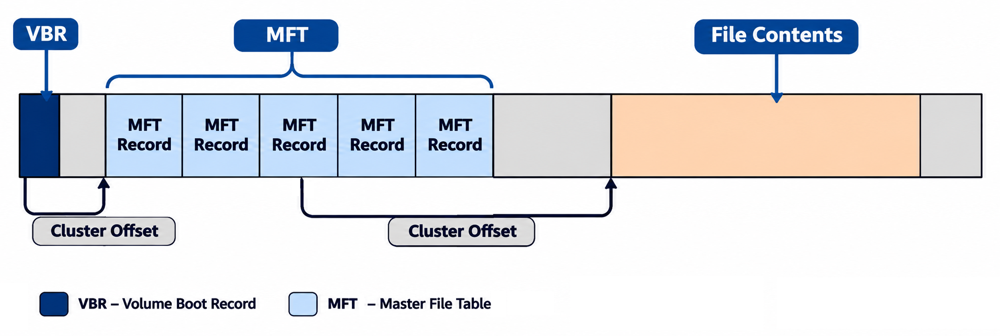

# NTFS Filesystem

In the previous section, we covered the [FAT filesystem](11_fat_filesystem.md) — a simple, widely compatible filesystem with significant limitations (4 GB max file size, no security features, no journaling). **NTFS** (New Technology File System) was designed by Microsoft to overcome these limitations.

NTFS was introduced in 1993 with Windows NT 3.1. It provides improved performance, security, reliability, and support for large storage devices. NTFS is the default filesystem on all modern Windows installations.

## NTFS Versions

| Version  | Year | Introduced With     | Key Features |
|----------|------|---------------------|--------------|
| NTFS 1.0 | 1993 | Windows NT 3.1      | Basic NTFS structure, file compression, Access Control Lists (ACLs) |
| NTFS 1.1 | 1995 | Windows NT 3.51     | Hard link support, performance improvements |
| NTFS 1.2 | 1996 | Windows NT 4.0      | Disk quotas, sparse files, file-level encryption |
| NTFS 3.0 | 2000 | Windows 2000        | Encrypting File System (EFS), reparse points, USN journal, sparse file enhancements |
| NTFS 3.1 | 2001 | Windows XP          | Enhanced security descriptors, Volume Shadow Copy, data integrity hardening |

> **Note:** The version numbering jumped from 1.2 to 3.0 to align with the Windows 2000 (NT 5.0) kernel version.

## Clusters in NTFS

Like FAT, NTFS uses **clusters** as the smallest unit of allocation, with the cluster size defined during formatting.

NTFS tracks cluster allocation using a **bitmap file** (`$Bitmap`), where each bit represents one cluster — `1` means allocated, `0` means free. This is more efficient than FAT's chain-based approach for large volumes.

## NTFS Internal Structure

An NTFS volume is laid out with the boot sector (VBR) first, followed by the MFT and file contents:

The diagram shows the **VBR** (Volume Boot Record) at the start, the **MFT** (Master File Table) consisting of multiple MFT records, and the **file contents** area. The cluster offsets stored in the VBR point to the MFT's location on disk.

### Boot Sector (VBR)

The boot sector — also called the **Partition Boot Sector** (PBS) or **Volume Boot Record** (VBR) — is the first sector of the partition, created during formatting. It contains essential metadata about the filesystem:

| Offset | Field Name                             | Size (Bytes) | Description |
|--------|----------------------------------------|--------------|-------------|
| 0x00   | JMP and NOP Instructions               | 3            | Jumps to bootstrap code, skipping the parameter block |
| 0x03   | OEM ID                                 | 8            | Filesystem identifier, typically "NTFS    " |
| 0x0B   | Bytes Per Sector                       | 2            | Bytes per sector (typically 512) |
| 0x0D   | Sectors Per Cluster                    | 1            | Sectors per cluster (determines allocation unit size) |
| 0x0E   | Reserved Sectors                       | 2            | Always 0 in NTFS |
| 0x10   | Unused                                 | 3            | Always 0 |
| 0x13   | Unused                                 | 2            | Always 0 |
| 0x15   | Media Descriptor                       | 1            | Media type (0xF8 = hard drive) |
| 0x16   | Unused                                 | 2            | Always 0 |
| 0x18   | Sectors Per Track                      | 2            | Sectors per track (disk geometry) |
| 0x1A   | Number of Heads                        | 2            | Number of read/write heads |
| 0x1C   | Hidden Sectors                         | 4            | Sectors before the start of this partition |
| 0x20   | Unused                                 | 4            | Always 0 |
| 0x24   | Unused                                 | 4            | Always 0 |
| 0x28   | Total Sectors                          | 8            | Total sectors in the partition |
| 0x30   | $MFT Cluster Number                    | 8            | Logical cluster number where the MFT starts |
| 0x38   | $MFTMirr Cluster Number                | 8            | Logical cluster number of the MFT mirror |
| 0x40   | Bytes/Clusters Per File Record Segment | 1            | Size of MFT file record segments |
| 0x41   | Unused                                 | 3            | Always 0 |
| 0x44   | Bytes/Clusters Per Index Buffer        | 1            | Size of index buffers |
| 0x45   | Unused                                 | 3            | Always 0 |
| 0x48   | Volume Serial Number                   | 8            | Unique volume identifier |
| 0x50   | Checksum                               | 4            | Reserved (not used by NTFS) |
| 0x54   | Bootstrap Code                         | 426          | Code to load the operating system |
| 0x1FE  | End-of-Sector Marker                   | 2            | Boot signature (0xAA55) |

Fields at offsets 0x0B–0x23 form the **BPB** (BIOS Parameter Block). Fields at 0x24–0x53 form the **Extended BPB**. This layout is based on the earlier FAT boot sector format, but the fields are in different locations.

> **Comparison with FAT:** Notice several fields are marked "Unused" or "Always 0" — these correspond to FAT-specific fields (like Number of FATs, Root Directory Entries) that NTFS does not use. NTFS keeps them at zero for structural compatibility.

## Master File Table (MFT)

The **MFT** is the central database of an NTFS volume. It stores metadata about **every** file and directory on the volume — including the MFT itself.

Unlike FAT, where metadata is spread across directory entries and the FAT table, NTFS consolidates everything into MFT records. Each file or directory gets at least one MFT record.

### Locating the MFT

The MFT does not start immediately after the boot sector. Instead, the boot sector contains a pointer to its location:

1. Read the **$MFT Cluster Number** (8 bytes at offset 0x30) — this is the logical cluster number (LCN) where the MFT begins.
2. Multiply by **Sectors Per Cluster** (1 byte at offset 0x0D) to get the sector offset (LBA) to the MFT.

A partial backup called the **MFT mirror** (`$MFTMirr`) is stored at a separate location (pointed to by offset 0x38). If the first MFT records are corrupted, NTFS can recover from the mirror.

### MFT Record Structure

Each file or directory is represented by an MFT record with a fixed-size header followed by variable-length attributes:

| Offset | Field Name | Description |
|--------|------------|-------------|
| 0x00   | Header     | Fixed-size metadata about the record |
| 0x38   | Attributes | One or more variable-length entries (filename, timestamps, data, etc.) |

**Header format:**

| Offset | Field Name                    | Size (Bytes) | Description |
|--------|-------------------------------|--------------|-------------|
| 0x00   | Signature                     | 4            | "FILE" — identifies this as an MFT record |
| 0x04   | Update Sequence Offset        | 2            | Offset to the update sequence field |
| 0x06   | Update Sequence Size          | 2            | Size of the update sequence array |
| 0x08   | Log File Sequence Number (LSN)| 8            | Tracks changes to this record for journaling |
| 0x10   | Sequence Number               | 2            | Incremented each time the record is reused |
| 0x12   | Hard Link Count               | 2            | Number of hard links pointing to this file |
| 0x14   | First Attribute Offset        | 2            | Offset to the first attribute |
| 0x16   | Flags                         | 2            | Record flags (e.g., in use, directory) |
| 0x18   | Used Size                     | 4            | Actual size of the record currently in use |
| 0x1C   | Allocated Size                | 4            | Total allocated size of the record |
| 0x20   | Base File Record              | 8            | Reference to base record (for multi-record files) |
| 0x28   | Next Attribute ID             | 2            | ID assigned to the next attribute |
| 0x2A   | Padding                       | 2            | Alignment padding |
| 0x2C   | MFT Record Number             | 4            | This record's number within the MFT |

### Attributes

Each MFT record contains one or more **attributes** that store different types of information about the file. Each attribute has a common header:

| Offset | Field Name          | Size (Bytes) | Description |
|--------|---------------------|--------------|-------------|
| 0x00   | Attribute Type      | 4            | Type identifier (e.g., $STANDARD_INFORMATION, $DATA) |
| 0x04   | Length              | 4            | Total size of the attribute (header + data) |
| 0x08   | Non-resident Flag   | 1            | 0 = resident (data stored in MFT), 1 = non-resident (data stored in clusters) |
| 0x09   | Name Length         | 1            | Length of the attribute's name |
| 0x0A   | Name Offset         | 2            | Offset to the attribute's name |
| 0x0C   | Flags               | 2            | Attribute flags (e.g., compressed, encrypted) |
| 0x0E   | Attribute Identifier| 2            | Unique ID for this attribute within the record |
| 0x10   | Data Length         | 4            | Length of the attribute's data |
| 0x14   | Data Offset         | 2            | Offset to the data within the attribute |
| 0x16   | Indexed Flag        | 1            | Whether this attribute is indexed (0 = no, 1 = yes) |
| 0x17   | Reserved            | 1            | Alignment padding |
| 0x18   | Data                | Variable     | Resident: data stored here. Non-resident: pointers to clusters |

An attribute's data can be **resident** (stored directly in the MFT record) or **non-resident** (stored in clusters on disk, with the MFT record holding pointers). Small files can fit entirely within the MFT record itself.

### Attribute Types

NTFS defines the following attribute types:

| Attribute Type          | ID (Hex) | Description |
|-------------------------|----------|-------------|
| $STANDARD_INFORMATION   | 0x10     | Timestamps (created, modified, accessed), permissions, flags |
| $ATTRIBUTE_LIST         | 0x20     | Lists all attributes when they span multiple MFT records |
| $FILE_NAME              | 0x30     | Filename, parent directory reference, namespace type |
| $OBJECT_ID              | 0x40     | Unique object identifier for the file or directory |
| $SECURITY_DESCRIPTOR    | 0x50     | Access control and security information (ACLs) |
| $VOLUME_NAME            | 0x60     | Name of the volume |
| $VOLUME_INFORMATION     | 0x70     | Volume version and state information |
| $DATA                   | 0x80     | The file's actual data (resident or non-resident) |
| $INDEX_ROOT             | 0x90     | Root of a directory index (B-tree) |
| $INDEX_ALLOCATION       | 0xA0     | Overflow space for directory index entries |
| $BITMAP                 | 0xB0     | Tracks cluster allocation within an index or volume |
| $REPARSE_POINT          | 0xC0     | Data for symbolic links, junction points, and mount points |
| $EA_INFORMATION         | 0xD0     | Extended attribute metadata |
| $EA                     | 0xE0     | Extended attribute data |
| $PROPERTY_SET           | 0xF0     | Reserved for Microsoft use |
| $LOGGED_UTILITY_STREAM  | 0x100    | Logged data for NTFS recovery |

### Reserved MFT Records

NTFS reserves the first 16 MFT records for special system files:

| Record | Filename              | Description |
|--------|-----------------------|-------------|
| 0      | $MFT                  | The Master File Table itself |
| 1      | $MFTMirr              | Backup of the first four MFT records |
| 2      | $LogFile              | Transaction log for journaling |
| 3      | $Volume               | Volume label, version, and state information |
| 4      | $AttrDef              | Definition of all attribute types |
| 5      | . (root directory)    | Root directory of the volume |
| 6      | $Bitmap               | Cluster allocation bitmap |
| 7      | $Boot                 | Boot sector and bootstrap code |
| 8      | $BadClus              | List of bad clusters on the volume |
| 9      | $Secure               | Security descriptors (ACLs) |
| 10     | $Upcase               | Uppercase mapping table for Unicode |
| 11     | $Extend               | Directory for extended system files ($Quota, $UsnJrnl, etc.) |
| 12–15  | (Reserved)            | Reserved for future use |

## Indexing and Journaling

NTFS uses **B-trees** to index directory contents, enabling fast file lookups even in directories with thousands of entries. This is a significant improvement over FAT, which uses linear scans through directory entries.

NTFS also maintains a **transaction journal** (`$LogFile`) that records all metadata changes before they are applied to the volume. If the system crashes or loses power, NTFS can replay or roll back incomplete transactions during the next mount, ensuring the filesystem remains consistent. This journaling protects the filesystem structure — though not individual file contents — making NTFS significantly more reliable than FAT.

[← Previous: FAT Filesystem](11_fat_filesystem.md) | [Next: ext Filesystem →](13_ext_filesystem.md)
