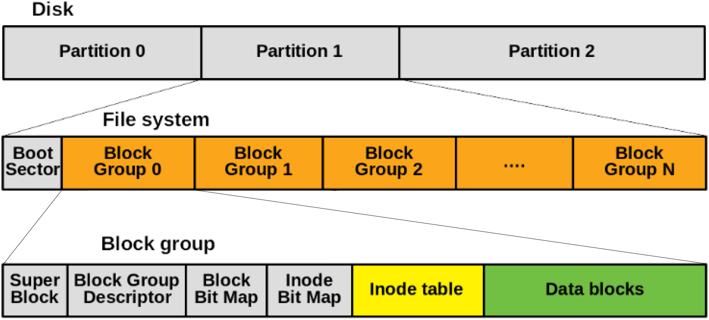
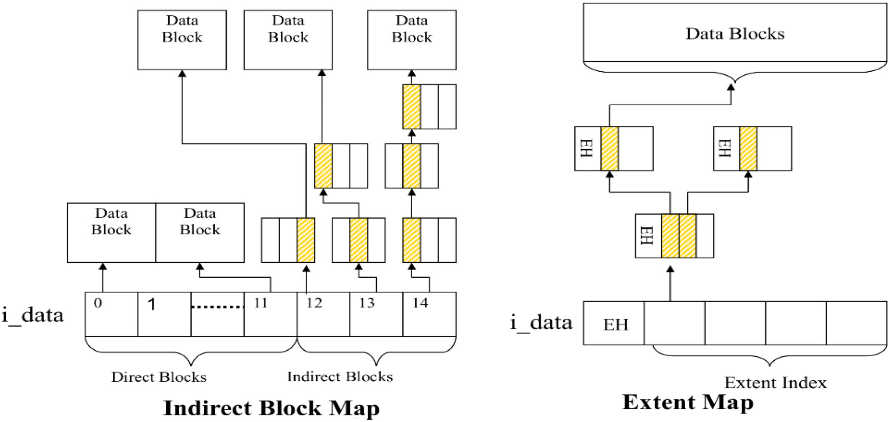
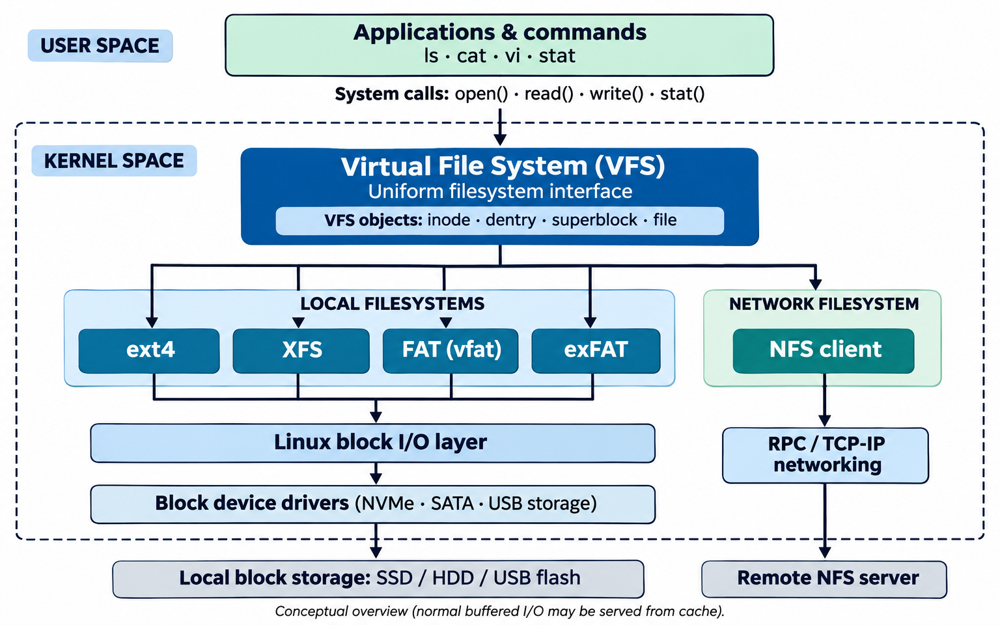

# ext Filesystem

In the previous sections, we covered [FAT](11_fat_filesystem.md) and [NTFS](12_ntfs_filesystem.md) — the primary filesystems for DOS and Windows. Now we turn to **ext** (Extended File System), the family of filesystems designed for Linux.

## ext Family Overview

The ext family has evolved through four major versions:

| Version | Year | Creator              | Max File Size | Max Volume Size | Key Features |
|---------|------|----------------------|---------------|-----------------|--------------|
| ext     | 1992 | Rémy Card            | 2 GB          | 2 GB            | First filesystem designed for Linux; 255-character filenames; no journaling |
| ext2    | 1993 | Rémy Card            | 2 TB          | 16 TB           | Improved scalability and performance; no journaling |
| ext3    | 2001 | Stephen Tweedie      | 2 TB          | 16 TB           | Added journaling for crash recovery; backward-compatible with ext2 |
| ext4    | 2006 | Theodore Ts'o et al. | 16 TB         | 1 EB            | Extents-based storage; delayed allocation; support for very large volumes |

ext4 was introduced in 2006 as a technology preview and officially merged into the Linux kernel in version 2.6.28 (December 2008). It has been the default filesystem on most major Linux distributions (Ubuntu, Fedora, Debian, etc.) ever since.

## ext4 Internal Structure

### Blocks

In FAT and NTFS, the minimum allocation unit is a [cluster](11_fat_filesystem.md#clusters) — a group of one or more [sectors](02_hdd_structure.md#sector). ext4 uses the same concept but calls it a **block**. A block is a group of adjacent sectors, and the number of sectors in a block must be a power of 2. This is stated directly in the [Linux kernel documentation](https://docs.kernel.org/filesystems/ext4/blocks.html):

> *"A block is a group of sectors between 1KiB and 64KiB, and the number of sectors must be an integral power of 2."*

ext4 supports block sizes from 1 KB to 64 KB ([Linux source code](https://github.com/torvalds/linux/blob/9bffa1ad25b8b3b95d8f463e5c24dabe3c87d54d/fs/ext4/ext4.h#L335)):

```c
#define EXT4_MIN_BLOCK_SIZE     1024
#define EXT4_MAX_BLOCK_SIZE     65536
```

The most common block size is **4 KB** (4096 bytes). With 512-byte sectors, one 4 KB block = 8 sectors. Like clusters in FAT, if a file doesn't fill its last block, the remaining space is wasted ([slack space](11_fat_filesystem.md#slack-space)).

The block size is chosen at format time (using `mkfs.ext4 -b <size>`) and cannot be changed afterward. It is stored in the superblock as `s_log_block_size`, where:

```
block_size = 1024 << s_log_block_size
```

For example, `s_log_block_size = 2` means `1024 << 2 = 4096` bytes (4 KB). A value of `0` means 1 KB, and `6` means 64 KB.

### Block Groups

ext4 divides the disk into multiple **block groups** to reduce fragmentation and improve performance. Each block group is a self-contained unit with its own metadata, inode table, and data blocks.

For example, a 1 GB disk with 4 KB blocks and 128 MB block groups would have approximately 8 block groups (`1 GB / 128 MB = 8`).

Each block group contains the following components:

| Component                    | Scope  | Description |
|------------------------------|--------|-------------|
| Superblock                   | Global | Backup of the primary superblock (for redundancy) |
| Block Group Descriptor Table | Global | Locations of bitmaps, inode tables, and free counts |
| Block Bitmap                 | Local  | Tracks block allocation (1 = allocated, 0 = free) |
| Inode Bitmap                 | Local  | Tracks inode allocation (1 = allocated, 0 = free) |
| Inode Table                  | Local  | File and directory metadata (permissions, timestamps, block pointers) |
| Data Blocks                  | Local  | Actual file and directory content |

**Global** components describe the entire filesystem and are identical across all block groups that carry them. **Local** components are unique to each block group and manage only the resources within it.



#### Block Group Advantages

- **Data locality** — related data (files, directories, metadata) is kept physically close, reducing seek times and speeding up file operations.
- **Fragmentation mitigation** — blocks and inodes for related data are allocated within the same group, keeping files contiguous.
- **Redundancy** — critical metadata (superblock, group descriptor table) is replicated across block groups; if the primary copy is corrupted, backups in other groups can recover it.
- **Parallel operations** — each block group has independent metadata, enabling concurrent file operations across different groups.

The primary superblock and block group descriptor table are stored at the start of block group 0. If the `sparse_super` feature is enabled (the default), backup copies are only placed in block groups whose numbers are powers of 3, 5, or 7 (e.g., block groups 1, 3, 5, 7, 9, 25, 27, 49, …). You can view the backup locations with `dumpe2fs /dev/sdX`.

### No Boot Sector (VBR)

In [FAT](11_fat_filesystem.md) and [NTFS](12_ntfs_filesystem.md), the very first sector of a partition is the Volume Boot Record (VBR) — a structure that **combines** boot code and filesystem metadata (BPB) in the same location. The filesystem's own metadata lives inside the VBR (see [FAT Boot Sector](11_fat_filesystem.md#boot-sector-vbr) and [NTFS Boot Sector](12_ntfs_filesystem.md#boot-sector-vbr)).

ext4 takes a different approach — it **separates** boot code from filesystem metadata. The first 1024 bytes of block group 0 are deliberately reserved and left empty by the filesystem. The [Linux kernel documentation](https://docs.kernel.org/filesystems/ext4/blockgroup.html) explains why:

> *"For the special case of block group 0, the first 1024 bytes are unused, to allow for the installation of x86 boot sectors and other oddities."*

This reserved space allows bootloaders (like GRUB) to install chain-loading code at the start of the partition without overwriting filesystem metadata. ext4 never reads from or writes to these bytes — all filesystem metadata begins at the **superblock**, which starts at byte offset 1024.

| Filesystem | First Structure on the Partition   | Offset | Purpose                                              |
|------------|------------------------------------|--------|------------------------------------------------------|
| FAT        | Boot Sector (VBR)                  | 0x000  | BPB + boot code + filesystem metadata                |
| NTFS       | Boot Sector (VBR)                  | 0x000  | BPB + Extended BPB + pointer to MFT                  |
| ext4       | *(reserved for boot code)*         | 0x000  | 1024 bytes reserved for bootloader use               |

### Superblock

The **superblock** is the most critical metadata structure in the filesystem. It describes the overall filesystem — its size, block size, number of inodes, free space, and more. The primary copy is at offset 1024 bytes from the start of the filesystem (always in block group 0).

| Field Name                | Size (Bytes) | Description |
|---------------------------|--------------|-------------|
| s_inodes_count            | 4            | Total number of inodes |
| s_blocks_count_lo         | 4            | Total number of blocks (lower 32 bits) |
| s_r_blocks_count_lo       | 4            | Blocks reserved for the superuser (lower 32 bits) |
| s_free_blocks_count_lo    | 4            | Free blocks (lower 32 bits) |
| s_free_inodes_count       | 4            | Free inodes |
| s_first_data_block        | 4            | ID of the first data block |
| s_log_block_size          | 4            | Block size = 1024 << s_log_block_size (e.g., 0 = 1 KB, 2 = 4 KB) |
| s_log_cluster_size        | 4            | Cluster size = 1024 << s_log_cluster_size |
| s_blocks_per_group        | 4            | Blocks per block group |
| s_clusters_per_group      | 4            | Clusters per group |
| s_inodes_per_group        | 4            | Inodes per block group |
| s_mtime                   | 4            | Last mount time (UNIX timestamp) |
| s_wtime                   | 4            | Last write time (UNIX timestamp) |
| s_mnt_count               | 2            | Mount count since last check |
| s_max_mnt_count           | 2            | Max mounts before a check is forced |
| s_magic                   | 2            | Magic number: `0xEF53` for ext2/ext3/ext4 |
| s_state                   | 2            | Filesystem state (1 = clean, 2 = errors) |
| s_errors                  | 2            | Behavior on errors (1 = continue, 2 = read-only) |
| s_minor_rev_level         | 2            | Minor revision level |
| s_lastcheck               | 4            | Last check time (UNIX timestamp) |
| s_checkinterval           | 4            | Max time between checks (seconds) |
| s_creator_os              | 4            | OS that created the filesystem |
| s_rev_level               | 4            | Major revision (0 = original, 1 = dynamic inode sizes) |
| s_def_resuid              | 2            | Default user ID for reserved blocks |
| s_def_resgid              | 2            | Default group ID for reserved blocks |
| s_first_ino               | 4            | First inode usable for standard files |
| s_inode_size              | 2            | Size of each inode (typically 256 bytes) |
| s_block_group_nr          | 2            | Block group number of this superblock |
| s_feature_compat          | 4            | Compatible feature flags |
| s_feature_incompat        | 4            | Incompatible feature flags |
| s_feature_ro_compat       | 4            | Read-only compatible feature flags |
| s_uuid                    | 16           | 128-bit UUID for the volume |
| s_volume_name             | 16           | Volume name |
| s_last_mounted            | 64           | Path where the filesystem was last mounted |
| s_algorithm_usage_bitmap  | 4            | Compression algorithms bitmap |
| s_prealloc_blocks         | 1            | Blocks to preallocate for files |
| s_prealloc_dir_blocks     | 1            | Blocks to preallocate for directories |
| s_reserved_gdt_blocks     | 2            | Reserved GDT entries for future expansion |
| s_journal_uuid            | 16           | UUID of the journal superblock |
| s_journal_inum            | 4            | Inode number of the journal file |
| s_journal_dev             | 4            | Device number of the journal file |
| s_last_orphan             | 4            | Head of the orphan inode list |
| s_hash_seed               | 16           | Seed for directory indexing hash |
| s_def_hash_version        | 1            | Default hash version for directory indexing |
| s_reserved_char_pad       | 3            | Alignment padding |
| s_desc_size               | 2            | Size of a group descriptor |
| s_default_mount_opts      | 4            | Default mount options |
| s_first_meta_bg           | 4            | First meta block group ID |
| s_reserved                | 760          | Reserved for future use |

The `s_magic` field identifies the filesystem type. The kernel checks this value when mounting to confirm it is reading a valid ext filesystem. For reference, other Linux filesystems use different magic numbers:

| Hex Value  | Filesystem |
|------------|------------|
| 0xEF53     | ext2/ext3/ext4 |
| 0x9123683E | Btrfs |
| 0x52654973 | ReiserFS |
| 0x5346414F | SquashFS |
| 0x137F     | Minix v1 |

### Block Group Descriptor Table

The block group descriptor table contains one entry per block group. Each entry records the locations of that group's bitmaps, inode table, and free space counts. The table is stored alongside the superblock and replicated in the same backup block groups.

Each entry has the following structure:

| Field Name              | Size (Bytes) | Description |
|-------------------------|--------------|-------------|
| bg_block_bitmap_lo      | 4            | Block bitmap location (lower 32 bits) |
| bg_inode_bitmap_lo      | 4            | Inode bitmap location (lower 32 bits) |
| bg_inode_table_lo       | 4            | Inode table start (lower 32 bits) |
| bg_free_blocks_count_lo | 2            | Free blocks in this group |
| bg_free_inodes_count_lo | 2            | Free inodes in this group |
| bg_used_dirs_count_lo   | 2            | Directories in this group |
| bg_flags                | 2            | Block group flags (e.g., BG_INODE_UNINIT) |
| bg_exclude_bitmap_lo    | 4            | Exclude bitmap location (lower 32 bits) |
| bg_block_bitmap_csum_lo | 2            | Block bitmap checksum (lower 16 bits) |
| bg_inode_bitmap_csum_lo | 2            | Inode bitmap checksum (lower 16 bits) |
| bg_itable_unused_lo     | 2            | Unused inodes in the inode table |
| bg_checksum             | 2            | Checksum of this descriptor |
| bg_block_bitmap_hi      | 4            | Block bitmap location (upper 32 bits, for 64-bit support) |
| bg_inode_bitmap_hi      | 4            | Inode bitmap location (upper 32 bits) |
| bg_inode_table_hi       | 4            | Inode table start (upper 32 bits) |
| bg_free_blocks_count_hi | 2            | Free blocks (upper 16 bits) |
| bg_free_inodes_count_hi | 2            | Free inodes (upper 16 bits) |
| bg_used_dirs_count_hi   | 2            | Directories (upper 16 bits) |
| bg_itable_unused_hi     | 2            | Unused inodes (upper 16 bits) |
| bg_exclude_bitmap_hi    | 4            | Exclude bitmap location (upper 32 bits) |
| bg_block_bitmap_csum_hi | 2            | Block bitmap checksum (upper 16 bits) |
| bg_inode_bitmap_csum_hi | 2            | Inode bitmap checksum (upper 16 bits) |
| Reserved                | 4            | Reserved for future use |

Fields with `_lo` and `_hi` suffixes provide 64-bit addressing for large filesystems.

### Block Bitmap

The block bitmap tracks which blocks in a block group are free and which are allocated. Each bit represents one block — `1` means allocated, `0` means free. For example, a block group with 8,192 blocks has a block bitmap of 8,192 bits (1,024 bytes).

### Inode Bitmap

The inode bitmap works the same way as the block bitmap but tracks inodes instead of blocks. Each bit represents one inode in the block group — `1` means the inode is allocated (in use by a file or directory), `0` means it is free. When a new file is created, the filesystem scans this bitmap to find the next available inode.

### Inode Table

The **inode table** is an array of inode structures stored within each block group. The term "inode" stands for **index node**. Every file and directory on an ext filesystem has exactly one inode. The inode stores all metadata about the file — size, permissions, timestamps, and pointers to data blocks — but **not** the file's name, which is stored in the parent directory's data blocks.

Each inode is a fixed-size structure (typically 256 bytes in ext4, 128 bytes in ext2/ext3):

| Field Name       | Size (Bytes) | Description |
|------------------|--------------|-------------|
| i_mode           | 2            | File type and access permissions |
| i_uid            | 2            | Owner user ID |
| i_size_lo        | 4            | File size (lower 32 bits) |
| i_atime          | 4            | Last access time (UNIX timestamp) |
| i_ctime          | 4            | Inode change time — when metadata was last modified (UNIX timestamp) |
| i_mtime          | 4            | File content modification time (UNIX timestamp) |
| i_dtime          | 4            | Deletion time (UNIX timestamp) |
| i_gid            | 2            | Owner group ID |
| i_links_count    | 2            | Number of hard links |
| i_blocks_lo      | 4            | 512-byte blocks allocated (lower 32 bits) |
| i_flags          | 4            | File flags (e.g., immutable, append-only) |
| i_osd1           | 4            | OS-specific data |
| i_block          | 60           | Pointers to data blocks or extents (12 direct, 1 indirect, 1 double-indirect, 1 triple-indirect) |
| i_generation     | 4            | File version (used by NFS) |
| i_file_acl_lo    | 4            | Extended attribute block (lower 32 bits) |
| i_size_high      | 4            | File size (upper 32 bits, for large files) |
| i_obso_faddr     | 4            | Obsolete fragment address |
| i_osd2           | 12           | Additional OS-specific data |
| i_extra_isize    | 2            | Extra inode size beyond the standard structure |
| i_checksum_hi    | 2            | Inode checksum (high 16 bits) |
| i_ctime_extra    | 4            | Extra change time (nanoseconds) |
| i_mtime_extra    | 4            | Extra modification time (nanoseconds) |
| i_atime_extra    | 4            | Extra access time (nanoseconds) |
| i_crtime         | 4            | File creation time (UNIX timestamp) |
| i_crtime_extra   | 4            | Extra creation time (nanoseconds) |
| i_version_hi     | 4            | Inode version (high 32 bits) |

> **Note:** `i_ctime` is the **inode change time** (when metadata like permissions or ownership was last modified) — not the file creation time. The actual creation time is stored in `i_crtime`, which was added in ext4.

The `i_block` field (60 bytes) is the key to locating a file's data on disk. In ext2/ext3, it holds **block pointers** organized in a tiered structure:

- **12 direct pointers** — each points directly to a data block. With 4 KB blocks, this covers files up to 48 KB.
- **1 indirect pointer** — points to a block that itself contains pointers to data blocks (adds ~4 MB).
- **1 double-indirect pointer** — points to a block of indirect pointers (adds ~4 GB).
- **1 triple-indirect pointer** — points to a block of double-indirect pointers (adds ~4 TB).

In ext4, the `i_block` field is repurposed to store **extents** instead — a more efficient mechanism described in the [ext4 Extents](#ext4-extents) section below.

For very small files (smaller than 60 bytes), ext4 can store the file's data directly inside the `i_block` field itself, avoiding the need to allocate a separate data block. This optimization is called **inline data**.

## File Type

The `i_mode` field is a 16-bit value encoding both the **file type** (upper 4 bits) and **permissions** (lower 12 bits).

The lower 12 bits are standard UNIX permissions (owner/group/others × read/write/execute), as covered in [File Permissions](10_metadata.md#file-permission).

The upper 4 bits define the file type:

| File Type        | Octal Value | Hex Value | Description |
|------------------|-------------|-----------|-------------|
| FIFO (Named Pipe)| 0010000     | 0x1000    | Inter-process communication |
| Character Device | 0020000     | 0x2000    | Character device driver |
| Directory        | 0040000     | 0x4000    | Container for files and directories |
| Block Device     | 0060000     | 0x6000    | Block device driver |
| Regular File     | 0100000     | 0x8000    | Standard file |
| Symbolic Link    | 0120000     | 0xA000    | Points to another file |
| Socket           | 0140000     | 0xC000    | Network or IPC socket |

## ext4 Extents

The most important feature distinguishing ext4 from ext2/ext3 is **extents**, which replace the indirect block pointer scheme described above.

The problem with indirect block pointers is that every data block requires its own pointer. A 1 GB file with 4 KB blocks needs over 260,000 individual pointers — spread across direct, indirect, double-indirect, and triple-indirect blocks. This creates significant metadata overhead and requires multiple disk reads just to locate the file's data.

Extents solve this by describing a **contiguous range of blocks** with a single compact descriptor:

| Field              | Size    | Description |
|--------------------|---------|-------------|
| Logical block      | 4 bytes | Starting block number within the file |
| Length             | 2 bytes | Number of contiguous blocks in this extent |
| Physical block     | 6 bytes | Starting block number on disk |

For example, a contiguous 1 GB file can be described by a single extent (starting block + 262,144 blocks) instead of 260,000+ individual pointers.



Benefits of extents:

- **Fewer metadata lookups** — one extent descriptor covers thousands of contiguous blocks, so the filesystem can locate data faster.
- **Reduced fragmentation** — the allocator prefers contiguous ranges, keeping files physically sequential on disk.
- **Better performance for large files** — sequential reads and writes are significantly faster because the filesystem knows the entire range of blocks in advance.

## Inode Numbers

Each inode has a unique **inode number** that the filesystem uses to locate it. The first few inode numbers are reserved:

| Inode | Purpose |
|-------|---------|
| 0     | Does not exist |
| 1     | Defective block list |
| 2     | Root directory |
| 3     | User quota |
| 4     | Group quota |
| 5     | Boot loader |
| 6     | Undelete directory |
| 7     | Reserved group descriptors ("resize inode") |
| 8     | Journal inode |
| 9     | Exclude inode (snapshots) |
| 10    | Replica inode |
| 11    | First non-reserved inode (typically `lost+found`). See `s_first_ino` in the superblock |

To determine which block group an inode belongs to:

```
block_group = (inode_number - 1) / s_inodes_per_group
```

For example, with `s_inodes_per_group = 8192`, inode 10302 belongs to block group 1:

```
(10302 - 1) / 8192 = 1
```

## `dumpe2fs`

`dumpe2fs` is a Linux utility that displays detailed information about ext2/ext3/ext4 filesystems. It reads the superblock and block group descriptors and prints their contents in a human-readable format:

```
$ dumpe2fs /dev/sdX
```

Key fields from a typical output and their corresponding superblock fields:

| dumpe2fs Field           | Superblock Field      | Example Value |
|--------------------------|-----------------------|---------------|
| Filesystem magic number  | s_magic               | 0xEF53 |
| Block size               | s_log_block_size      | 4096 |
| Inode count              | s_inodes_count        | 20,365,312 |
| Block count              | s_blocks_count        | 81,440,256 |
| Free blocks              | s_free_blocks_count   | 60,123,522 |
| Blocks per group         | s_blocks_per_group    | 32,768 |
| Inodes per group         | s_inodes_per_group    | 8,192 |
| Inode size               | s_inode_size          | 256 |
| Filesystem state         | s_state               | clean |

From this output, we can calculate:

```
Number of block groups = Total blocks / Blocks per group
                       = 81,440,256 / 32,768
                       = 2,486 block groups
```

## `filefrag` Command

`filefrag` is a Linux utility that reports the extent layout and fragmentation status of a file:

```
$ filefrag -v myfile.txt
Filesystem type is: ef53
File size of myfile.txt is 1048576 (256 blocks of 4096 bytes)
 ext:     logical_offset:        physical_offset: length:   expected: flags:
   0:        0..     255:      34816..     35071:    256:             last,eof
myfile.txt: 1 extent found
```

The output shows how many extents a file occupies and their physical block mappings. A file with a single extent is stored contiguously on disk, which is ideal. A file with many extents is fragmented — its data is scattered across different locations, which can slow down access on mechanical hard drives.

## Root Directory Location

The root directory (`/`) always has **inode number 2**. The superblock does not contain a direct pointer to the root directory — instead, the filesystem locates it using the inode number and structural fields:

1. Use `s_inodes_per_group` to determine which block group contains inode 2 (always block group 0).
2. Look up the inode table location from the block group descriptor for group 0.
3. Use `s_inode_size` to calculate the offset of the second entry within the inode table.

The root directory's inode then points to the data blocks containing the directory listing of `/`.

## Pseudo-filesystems

Beyond ext and other on-disk filesystems, Linux also uses several **pseudo-filesystems** — virtual filesystems that do not correspond to any physical storage device. Instead, they provide live interfaces to kernel internals and system information:

| Mount Point | Filesystem | Description |
|-------------|------------|-------------|
| `/dev`      | devtmpfs   | Device nodes for hardware devices (e.g., `/dev/sda`, `/dev/tty`) |
| `/proc`     | procfs     | Process and system information (e.g., `/proc/cpuinfo`, `/proc/meminfo`) |
| `/sys`      | sysfs      | Kernel objects and device attributes (e.g., `/sys/class/net`) |

Pseudo-filesystems are generated dynamically at boot, mounted in RAM, and are not stored on disk. Their contents are created on-the-fly by the kernel each time they are read.

## Virtual File System (VFS)

If [FAT](11_fat_filesystem.md) has no [inodes](#inode-table), why do FAT files show inode numbers on Linux (e.g., with `ls -i`)?

The answer is the **Virtual File System** (VFS) — an abstraction layer inside the Linux kernel that sits between user-space applications and the actual filesystem drivers:



The VFS presents a **uniform interface** to all filesystems — regardless of whether the underlying format uses inodes (ext4), MFT records (NTFS), or directory entries (FAT). Every file on Linux is represented by a VFS inode in memory. For filesystems like FAT that don't have native inodes, the filesystem driver generates temporary inode numbers at mount time.

This is why `ls -i` shows inode numbers even on a mounted FAT32 partition — the numbers are assigned by the VFS, not stored on disk. If you unmount and remount the partition, the inode numbers may change.


[← Previous: NTFS Filesystem](12_ntfs_filesystem.md) | [Next: Filesystem Hierarchy →](14_filesystem_hierarchy.md)
