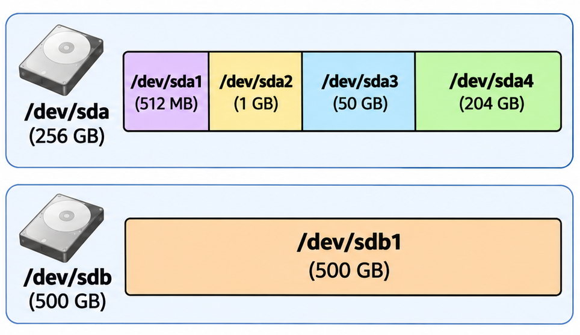
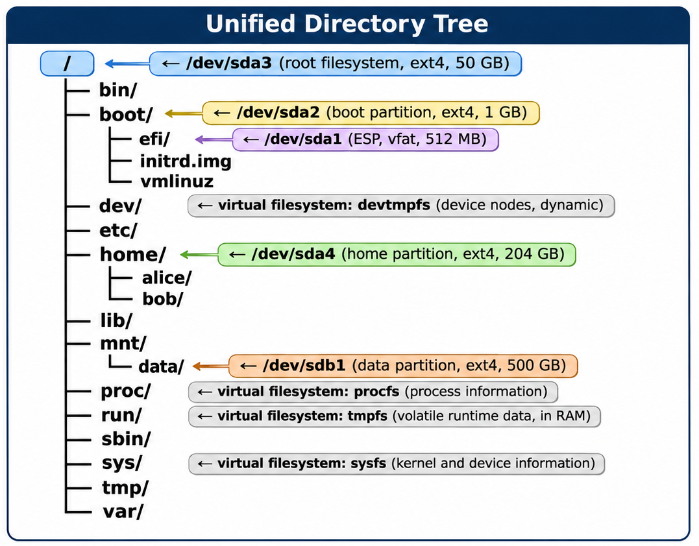

# Mounting

In Linux, every disk, partition, and device must be **mounted** before its files can be accessed. Mounting is the process of attaching a filesystem to a specific directory in the [directory tree](14_filesystem_hierarchy.md). Once mounted, the files on that device appear as ordinary files and folders under that directory.

The directory where a filesystem is attached is called a **mount point**. For example, if a USB drive is mounted at `/mnt/usb`, its contents become accessible under `/mnt/usb/`.

> **Why is mounting needed?** Unlike Windows, which assigns each device a separate drive letter (`C:`, `D:`), Linux uses a single unified directory tree rooted at `/`. Mounting is the mechanism that brings storage devices into this tree.

## How the Directory Tree Is Built

During boot, Linux assembles its directory tree one mount at a time — starting with the root partition, then layering additional filesystems on top. This section traces that process, showing how separate partitions merge into a single unified hierarchy.


> For a detailed walkthrough of the boot process — from power-on through firmware, bootloaders, and kernel initialization — see the [OS Boot Process](https://github.com/ManiAm/os-boot-process) guide. The steps below focus specifically on how mounting builds the directory tree.

The following example system is referenced throughout this section.

### Our Example System

The example system has two physical disks with five partitions total.



- **`/dev/sda`** — the first disk (256 GB), partitioned into four partitions (a typical [UEFI + GPT expanded layout](07_partition_layout.md#linux--uefi--gpt)):

| Partition    | Size   | Filesystem | Purpose                                       |
|--------------|--------|------------|-----------------------------------------------|
| `/dev/sda1`  | 512 MB | FAT32      | EFI System Partition (UEFI bootloader)        |
| `/dev/sda2`  | 1 GB   | ext4       | Boot partition (kernel and initramfs)         |
| `/dev/sda3`  | 50 GB  | ext4       | Root partition (the base operating system)    |
| `/dev/sda4`  | 204 GB | ext4       | Home partition (user files)                   |

- **`/dev/sdb`** — the second disk (500 GB), with one partition:

| Partition    | Size   | Filesystem | Purpose            |
|--------------|--------|------------|--------------------|
| `/dev/sdb1`  | 500 GB | ext4       | Extra data storage |

### Before Mounting Begins

Before any disk partition is mounted, the system goes through several boot stages (covered in detail in the [OS Boot Process](https://github.com/ManiAm/os-boot-process) guide):

1. **UEFI firmware** reads the EFI System Partition (`/dev/sda1`) and launches the bootloader (GRUB).
2. **GRUB** loads the Linux kernel (`vmlinuz`) and initramfs from the boot partition (`/dev/sda2`) into RAM.

### Step 0: Kernel Loads the initramfs

The kernel unpacks the **initramfs** — a compressed archive containing a small **temporary** root filesystem — into RAM and mounts it at `/`.

The initramfs is a self-contained mini root filesystem. Its layout follows the same core structure across all distributions and generators (`initramfs-tools`, `dracut`, `mkinitcpio`):

```
/                        ← initramfs, mounted in RAM
├── init                 ← entry point — the kernel runs this as PID 1
├── bin/                 ← essential tools (busybox or individual binaries)
├── dev/                 ← populated by devtmpfs at boot
├── etc/                 ← minimal config (crypttab, modprobe.conf)
├── lib/
│   └── modules/         ← kernel modules needed to access the root device
│       └── 6.x.x/       (e.g., dm-mod.ko for LVM, ext4.ko, nvme.ko)
├── proc/                ← mount point for procfs
├── run/                 ← mount point for tmpfs
├── sbin/                ← switch_root, modprobe
├── sys/                 ← mount point for sysfs
└── sysroot/             ← mount point for the real root partition
```

The `/init` script mounts virtual filesystems (`/proc`, `/sys`, `/dev`), loads any kernel modules needed to access the root device (e.g., for [LVM](06_lvm.md), RAID, or encrypted disks), and prepares the system for the first real mount. At this point, the initramfs is running in RAM and no disk partition has been mounted yet.

### Step 1: The Root Filesystem — The First Real Mount

The initramfs `/init` script reads the kernel's `root=` boot parameter (e.g., `root=/dev/sda3`) to locate the root partition. It mounts this partition at `/sysroot`, then calls `switch_root` — which replaces the temporary initramfs with the real root filesystem at `/`. The initramfs is discarded, and `/dev/sda3` becomes the root of the directory tree.

The root partition (`/dev/sda3`) contains the base operating system: the [FHS directory layout](14_filesystem_hierarchy.md) along with all installed software and configuration files. At this point, the directory tree looks like this:

```
/                        ← /dev/sda3 mounted here
├── bin/
├── boot/                ← empty directory (mount point, nothing mounted yet)
├── dev/                 ← empty directory (mount point for virtual filesystem)
├── etc/
│   └── fstab            ← tells the system what else to mount
├── home/                ← empty directory (mount point, nothing mounted yet)
├── lib/
├── mnt/
│   └── data/            ← empty directory (mount point, nothing mounted yet)
├── proc/                ← empty directory (mount point for virtual filesystem)
├── run/                 ← empty directory (mount point for virtual filesystem)
├── sbin/
│   └── init             ← switch_root hands control here (becomes PID 1)
├── sys/                 ← empty directory (mount point for virtual filesystem)
├── tmp/
└── var/
```

The directories `/boot`, `/home`, and `/mnt/data` exist as **empty mount points** — they were created by the distribution's installer specifically so that other partitions can be mounted there later. Note that `/boot/efi` is not visible yet — that subdirectory exists on the `/dev/sda2` filesystem, which has not been mounted at `/boot`.

### Step 2: Virtual Filesystems

With the root filesystem in place, `switch_root` hands control to **`/sbin/init`** on the real root partition, which takes over as PID 1. On most modern distributions, `/sbin/init` is **systemd**. One of the first things the init system does is mount several **virtual filesystems** — kernel-backed filesystems that exist only in memory and provide live interfaces to hardware, processes, and system state:

| Mount Point | Type      | Purpose                                           |
|-------------|-----------|---------------------------------------------------|
| `/dev`      | devtmpfs  | Device files (`/dev/sda`, `/dev/null`, etc.).     |
| `/proc`     | procfs    | Process and system information (CPU, memory).     |
| `/run`      | tmpfs     | Runtime data for the current boot session.        |
| `/sys`      | sysfs     | Hardware and device attributes.                   |

Virtual filesystems consume no disk space and are recreated fresh on every boot. The init system needs them in place before it can process disk partitions — for example, `/dev` provides the device nodes (such as `/dev/sda2`) that identify each partition.

### Step 3: Init Mounts the Remaining Partitions

With virtual filesystems ready, the init system reads **`/etc/fstab`** (filesystem table) — a configuration file on the root partition that lists which partitions should be mounted and where. For our example system, `/etc/fstab` contains:

```
# <source>                                 <target>     <type>  <options>      <dump> <pass>
UUID=3e2a1f4b-8c7d-4e6a-9b1c-5d2f0e8a7c3b  /            ext4    defaults       0      1
UUID=a1b2c3d4-5e6f-7a8b-9c0d-1e2f3a4b5c6d  /boot        ext4    defaults       0      2
UUID=b2c3d4e5-6f7a-8b9c-0d1e-2f3a4b5c6d7e  /boot/efi    vfat    umask=0077     0      2
UUID=7f4a2b1c-9d3e-4f5a-8c6b-1e2d0f9a3b7c  /home        ext4    defaults       0      2
/swapfile                                  none         swap    sw             0      0
```

The init system processes this file and mounts each partition at its designated mount point:

- `/dev/sda2` → mounted at **`/boot`** — the kernel and initramfs files (`vmlinuz`, `initrd.img`) now appear under `/boot/`.
- `/dev/sda1` → mounted at **`/boot/efi`** — the UEFI bootloader files now appear under `/boot/efi/`. This must happen *after* `/boot` is mounted, because `/boot/efi` is a subdirectory inside the `/boot` mount. Systemd resolves this dependency automatically.
- `/dev/sda4` → mounted at **`/home`** — user home directories (`alice/`, `bob/`) now appear under `/home/`.

> **Note:** The `/swapfile` entry in fstab is not a mount — it activates a file on the root partition as swap space (virtual memory). The init system handles it with `swapon` rather than `mount`.

The tree has grown:

```
/                        ← /dev/sda3
├── bin/
├── boot/                ← /dev/sda2 now mounted here
│   ├── efi/             ← /dev/sda1 (ESP) now mounted here
│   ├── initrd.img
│   └── vmlinuz
├── dev/                 ← virtual (devtmpfs) — mounted in Step 2
├── etc/
├── home/                ← /dev/sda4 now mounted here
│   ├── alice/
│   └── bob/
├── lib/
├── mnt/
│   └── data/            ← still empty (not in fstab)
├── proc/                ← virtual (procfs) — mounted in Step 2
├── run/                 ← virtual (tmpfs) — mounted in Step 2
├── sbin/
├── sys/                 ← virtual (sysfs) — mounted in Step 2
├── tmp/
└── var/
```

### Step 4: User Mounts Additional Storage

The boot process is now complete and the system is fully operational. The second disk (`/dev/sdb`) was not listed in `/etc/fstab`, so it is not mounted automatically. A user or administrator can mount it manually at any time:

```
$ sudo mount -t ext4 /dev/sdb1 /mnt/data
```

### The Complete Tree

After all steps are finished, the unified directory tree looks like this:



From the user's perspective, this looks like one seamless directory tree. The fact that `/home` and `/mnt/data` live on entirely different partitions — or even different physical disks — is invisible. You navigate between them just like any other directory.

### Kernel vs Distribution Responsibilities

Looking back at the boot process, the **kernel** and the **distribution** each handle distinct parts:

| Responsibility                        | Handled By              | Details                                                                                         |
|---------------------------------------|-------------------------|-------------------------------------------------------------------------------------------------|
| Filesystem drivers (ext4, FAT, etc.)  | Kernel                  | The kernel contains the code to read and write each filesystem format.                          |
| Mounting the root filesystem          | Kernel (via initramfs)  | The `root=` boot parameter identifies the root partition; the initramfs mounts it and calls `switch_root`. |
| Executing the first process           | Kernel                  | The kernel starts PID 1 — initially `/init` from the initramfs, which hands off to `/sbin/init` via `switch_root`. |
| Creating the directory layout         | Distribution            | The distro's installer creates `/bin`, `/etc`, `/home`, etc. following the [FHS](14_filesystem_hierarchy.md). |
| Mounting other filesystems            | Distribution (init)     | The init system (e.g., systemd) reads `/etc/fstab` and mounts the remaining partitions.        |
| Installing packages and tools         | Distribution            | The distro's package manager populates the directories with software.                           |

The kernel itself does not enforce any particular directory structure — it only requires a root partition and an init process. The [FHS directory layout](14_filesystem_hierarchy.md) is entirely a distribution convention.

## The `mount` Command

The `mount` command attaches a filesystem to a directory in the tree (the mount point). Every mount operation involves four pieces of information:

| Piece    | Description                                                   | Example                         |
|----------|---------------------------------------------------------------|---------------------------------|
| Source   | The device or partition being mounted.                        | `/dev/sda1`, `/dev/sdb1`       |
| Target   | The directory (mount point) where the filesystem appears.     | `/mnt/data`, `/media/usb`      |
| Type     | The filesystem format on the device.                          | `ext4`, `vfat`, `ntfs`, `tmpfs`|
| Options  | Flags that control how the filesystem is mounted.             | `rw`, `ro`, `noexec`, `defaults`|

```
$ sudo mount -t ext4 /dev/sdb1 /mnt/data
```

This mounts the ext4 filesystem on `/dev/sdb1` at the directory `/mnt/data`. The `-t` flag specifies the filesystem type — if omitted, `mount` attempts to detect it automatically.

### Mount Options

| Option     | Description                                                        |
|------------|--------------------------------------------------------------------|
| `rw`       | Mount as read-write (default).                                     |
| `ro`       | Mount as read-only.                                                |
| `noexec`   | Prevent execution of binaries on this filesystem.                  |
| `nosuid`   | Ignore set-user-ID and set-group-ID bits.                          |
| `nodev`    | Ignore device files on this filesystem.                            |
| `auto`     | Can be mounted automatically with `mount -a`.                      |
| `noauto`   | Must be mounted manually (skipped by `mount -a`).                  |
| `defaults` | Shorthand for `rw,suid,dev,exec,auto,nouser,async`.               |

The `-o` flag passes mount options. For example, to mount a FAT32 USB drive as read-only:

```
$ sudo mount -t vfat -o ro /dev/sdc1 /media/usb
```

Running `mount` with no arguments displays all currently mounted filesystems:

```
$ mount
/dev/sda3 on / type ext4 (rw,relatime)
tmpfs on /run type tmpfs (rw,nosuid,nodev)
/dev/sda2 on /boot type ext4 (rw,relatime)
/dev/sda1 on /boot/efi type vfat (rw,relatime,umask=0077)
/dev/sdb1 on /mnt/data type ext4 (rw,relatime)
```

Each line shows the source device, mount point, filesystem type, and active options.

## The `umount` Command

`umount` detaches a mounted filesystem from the directory tree:

```
$ sudo umount /mnt/data
```

You can specify either the mount point or the device:

```
$ sudo umount /dev/sdb1
```

A filesystem cannot be unmounted while it is in use — for example, if a process has an open file on it, or if a shell's current working directory is inside the mount point. In that case, `umount` reports the error "target is busy."

> **Note:** The command is `umount` (not "unmount") — the missing 'n' is a historical quirk from early Unix.

## `/etc/fstab`

Mounts performed with the `mount` command are **temporary** — they are lost after a reboot. To make mounts **persistent**, they are defined in `/etc/fstab` (filesystem table). The init system reads this file during boot and automatically mounts the listed filesystems (as shown in [Step 3](#step-3-init-mounts-the-remaining-partitions)).

Each line in `/etc/fstab` has six fields:

| Field   | Description                                                             | Example                |
|---------|-------------------------------------------------------------------------|------------------------|
| Source  | Device, UUID, or label to mount.                                        | `UUID=a1b2c3...`, `/dev/sda1` |
| Target  | Mount point directory.                                                  | `/`, `/home`, `/mnt/data` |
| Type    | Filesystem type.                                                        | `ext4`, `vfat`, `swap` |
| Options | Mount options.                                                          | `defaults`, `ro,noexec`|
| Dump    | Backup flag for the `dump` utility (0 = skip, 1 = include).            | `0`                    |
| Pass    | `fsck` check order at boot (0 = skip, 1 = root first, 2 = others).     | `1`                    |

> **Note:** Using `UUID` instead of device names (like `/dev/sda1`) is preferred because UUIDs are unique and stable — device names can change if disks are added, removed, or reordered.

To mount all filesystems listed in `/etc/fstab` without rebooting:

```
$ sudo mount -a
```

## Inspecting Mounts

### `findmnt`

`findmnt` displays the mount tree in a structured format, showing the relationships between mount points:

```
$ findmnt
TARGET                       SOURCE     FSTYPE   OPTIONS
/                            /dev/sda3  ext4     rw,relatime
├─/sys                       sysfs      sysfs    rw,nosuid,nodev,noexec
├─/proc                      proc       proc     rw,nosuid,nodev,noexec
├─/dev                       udev       devtmpfs rw,nosuid,relatime
├─/run                       tmpfs      tmpfs    rw,nosuid,nodev
├─/boot                      /dev/sda2  ext4     rw,relatime
│ └─/boot/efi                /dev/sda1  vfat     rw,relatime,umask=0077
├─/home                      /dev/sda4  ext4     rw,relatime
└─/mnt/data                  /dev/sdb1  ext4     rw,relatime
```

The tree view makes it easy to see how filesystems are layered. To query a specific mount point:

```
$ findmnt /mnt/data
TARGET    SOURCE    FSTYPE OPTIONS
/mnt/data /dev/sdb1 ext4   rw,relatime
```

### `df`

`df` (disk free) reports disk space usage for each mounted filesystem:

```
$ df -h
Filesystem      Size  Used Avail Use% Mounted on
/dev/sda3        50G   12G   35G  26% /
/dev/sda2       1.0G   80M  860M   9% /boot
/dev/sda1       511M  5.8M  505M   2% /boot/efi
/dev/sda4       204G   15G  179G   8% /home
/dev/sdb1       500G   40G  435G   9% /mnt/data
tmpfs           4.0G     0  4.0G   0% /run
```

The `-h` flag displays sizes in human-readable format (GB, MB). Without it, sizes are shown in 1 KB blocks.

[← Previous: Filesystem Hierarchy](14_filesystem_hierarchy.md)
